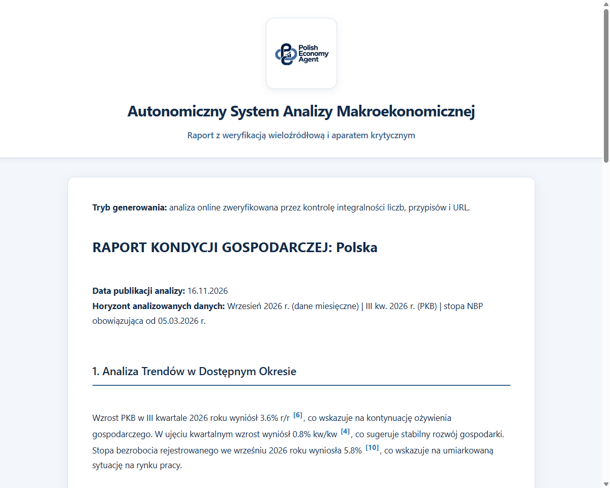
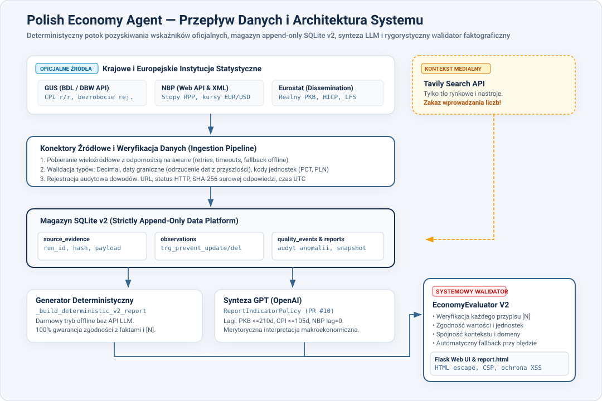

<p align="center">
  
</p>

<h1 align="center">Polish Economy Agent</h1>

<p align="center">
  <strong>Audit-first macroeconomic data engineering platform &amp; autonomous reporting agent for Poland</strong>
</p>

<p align="center">
  <a href="#english">English</a> • <a href="#polski">Polski</a>
</p>

<p align="center">
  
  
  
  
</p>

<p align="center">
  <a href="#report-preview-en"></a>
</p>

---

## Language / Język

- [English](#english)
  - [Overview](#overview)
  - [Key Architecture & Data Flow](#key-architecture--data-flow)
  - [Features](#features)
  - [Report Preview](#report-preview-en)
  - [Quickstart (Offline by default)](#quickstart-offline-by-default)
  - [Optional Online Mode](#optional-online-mode)
  - [Local Diagnostics & Debug Trace](#local-diagnostics--debug-trace)
  - [Tests & Quality Audit](#tests--quality-audit)
  - [Scope and Limitations](#scope-and-limitations)
- [Polski](#polski)
  - [O projekcie](#o-projekcie)
  - [Architektura i przepływ danych](#architektura-i-przepływ-danych)
  - [Funkcjonalności](#funkcjonalności)
  - [Podgląd przykładowego raportu](#podgląd-przykładowego-raportu)
  - [Szybki start (Domyślnie offline)](#szybki-start-domyślnie-offline)
  - [Opcjonalny tryb online](#opcjonalny-tryb-online)
  - [Lokalna diagnostyka i ślad wykonania](#lokalna-diagnostyka-i-ślad-wykonania)
  - [Testy i audyt jakości](#testy-i-audyt-jakości)
  - [Zakres i ograniczenia](#zakres-i-ograniczenia)

---

<a id="english"></a>

## English

### Overview

**Polish Economy Agent** is an engineering portfolio project demonstrating a verifiable, audit-first pipeline for macroeconomic data. It retrieves official statistical observations from the National Bank of Poland (**NBP**), Statistics Poland (**GUS**), and **Eurostat**, stores immutable raw evidence and structured observations in an append-only **SQLite v2** platform, enriches findings with contextual search (**Tavily**), and synthesizes multi-section analytical reports via **OpenAI GPT** or a deterministic offline engine.

Unlike naive LLM wrappers, the system implements an econometric verification barrier: numbers in the report must strictly originate from verified statistical records, every factual statement carries a traceable footnote `[N]` linked to a verified source endpoint URL, and search results are strictly quarantined as media commentary (never converted into official statistical claims).

> **Disclaimer:** This project is an educational, engineering prototype developed for portfolio purposes. It is not an investment advisory service, official statistical publication, or automated trading tool.

---

### Key Architecture & Data Flow

The platform enforces clean separation between official data ingestion, audit storage, contextual enrichment, and report validation.

<p align="center">
  
</p>
<p align="center"><em>Figure 1: End-to-end architecture and data lineage of the Polish Economy Agent.</em></p>

1. **Connector Layer:** Dedicated API clients for GUS (BDL & DBW API), NBP (Web API & XML policy rates), and Eurostat (Dissemination API).
2. **Ingestion & Validation:** Strict typing with Python `Decimal`, date boundary checks (rejects future-dated releases), frequency matching, and payload SHA-256 hashing.
3. **Storage (SQLite v2):** Audit-first relational database with append-only triggers on `observations` (`trg_observations_prevent_update`, `trg_observations_prevent_delete`), run-scoped lineage (`source_evidence.run_id`), and anomaly logging (`quality_events`).
4. **Indicator Freshness Policy (`ReportIndicatorPolicy`):** Evaluates timeliness tailored to reporting frequencies — quarterly GDP allows natural 45–90d publication lag (valid up to 210d as `CURRENT`), monthly CPI and registered unemployment allow up to 105d as `CURRENT`, and the active NBP reference rate is maintained as legally binding (`EFFECTIVE`, lag = 0d).
5. **Synthesis & Dual Generator:**
   - **Live GPT Synthesis:** OpenAI GPT (`gpt-4o`) guided by strict econometric constraints and macroeconomic analysis prompts. In live mode, validation rejection or API error results in a safe `FAILED` run without persisting any report (no automatic fallback to offline report).
   - **Deterministic Offline Generator:** Dedicated rule-based engine for offline demonstration and testing without external LLM calls.
6. **Quality Gate (`EconomyEvaluator`):** Rigorous anti-hallucination barrier verifying all numerical claims, unit symbols, and cross-domain contexts.
7. **Presentation:** Local Flask application serving sanitized, XSS-protected HTML reports (`app.py`).

---

### Features

- **Multi-Source Official Connectors:** NBP (FX exchange rates table A, reference rate), GUS DBW (registered unemployment rate, CPI year-over-year index base 100), and Eurostat (real GDP volume, QoQ, YoY, and HICP).
- **Strict CPI Ingestion:** Direct retrieval from GUS DBW requiring presentation mode 5 (`id-sposob-prezentacji-miara=5`, previous year = 100), eliminating ambiguity or methodology guessing.
- **Adaptive Publication Cycles:** Natural publication lags respected without false disclaimers; latest quarterly GDP and monthly inflation figures serve as sound foundations for substantive economic analysis.
- **Append-Only SQLite v2 Storage:** Schema with foreign keys, database triggers blocking mutations or deletions, and full `run_id` lineage tracking.
- **Quarantined Contextual Search:** Tavily search provides market context and official communiqués; numbers from search snippets are strictly isolated and never treated as statistical observations.
- **Structured 6-Section Report:** Standardized economic structure with numbered footnotes, direct verified endpoint URLs, header branding, and explicit `Brak danych` (Data unavailable) flags if data is missing.
- **Deterministic Offline Mode:** Complete zero-cost execution mode for offline testing and continuous integration without any external API calls.
- **Enterprise Diagnostics:** Secret-redacted logging in `agent.log`, run summary in `last_run.json` (created atomically at run start), and granular step traces in `steps.jsonl`.

---

<a id="report-preview-en"></a>

### Report Preview

<p align="center">
  
</p>
<p align="center"><em>Figure 2: Sample generated macroeconomic report preview featuring institutional header, executive summary, GDP analysis, and verified footnotes.</em></p>

---

### Quickstart (Offline by default)

**Prerequisites:** Python 3.11+ and [`uv`](https://docs.astral.sh/uv/) package manager.

```bash
git clone https://github.com/maciejkubek-maker/polish-economy-agent.git
cd polish-economy-agent
cp .env.example .env
uv sync --group dev
uv run python app.py
```

> **Windows PowerShell note:** Use `Copy-Item .env.example .env` instead of `cp`. The default example file contains `OFFLINE_MODE=true` and empty API keys.

Open <http://127.0.0.1:5000/> or <http://127.0.0.1:5000/report.html> in your browser. Press `Ctrl+C` in the terminal to stop the local server.

The application runs safely offline without requiring external API keys. Do not configure `DB_V2_PATH` to point to `instance/economy_agent.db`; that legacy database is protected and must remain untouched.

---

### Optional Online Mode

Online mode connects to live external APIs (GUS, NBP, Eurostat, Tavily, OpenAI). Enable it deliberately:

1. Configure your local, uncommitted `.env` file:
   ```dotenv
   OFFLINE_MODE=false
   DB_V2_PATH=instance/economy_agent_v2.db
   
   OPENAI_API_KEY=your_openai_key
   TAVILY_API_KEY=your_tavily_key
   ```
2. Run the application:
   ```bash
   uv run python app.py
   ```

Online report generation utilizes OpenAI GPT (`gpt-4o`) via LangChain. In live mode, reports must pass strict factual validation against official records. Section 6 (Bibliography) is assembled programmatically from the citation registry with direct URLs. If validation fails or an API error occurs, the run fails safely (`FAILED`, `report_id=null`) without writing partial files or invoking any substitute report.

---

### Local Diagnostics & Debug Trace

Every execution writes secret-redacted diagnostics to `instance/logs/` (ignored by Git):

- `agent.log`: Rotating application event and error log; validator approvals and rejections are tagged with the run's `run_id`.
- `last_run.json`: Run metadata initiated at pipeline start (`STARTED`) and updated at completion with execution status, verified indicators, and report ID.
- `steps.jsonl`: Structured trace recording `START`, `END`, and `ERROR` for all pipeline stages (`fetch_nbp`, `fetch_eurostat`, `fetch_gus`, `search_tavily`, `gpt_synthesis`, `validate_report`, `store_sqlite`, `write_html`) with elapsed durations in milliseconds.

---

### Tests & Quality Audit

The full test suite covers connector isolation, schema migrations, freshness policy, calculation of derived real interest rates, and HTML security.

```bash
uv sync --group dev
uv run pytest
```

- **Latest Verified Audit Result:** **`233 passed in 14.03s`** *(measured during earlier local audit in Python 3.11.16 environment)*.

---

### Scope and Limitations

- **Indicator Coverage:** Currently focused on core macroeconomic indicators (GDP, CPI, HICP, registered unemployment, LFS unemployment, NBP reference rate, EUR/PLN, USD/PLN). Labor market wage indicators (`PL_WAGE_AVERAGE_GROSS`) require explicit BDL variable mapping.
- **Multi-Horizon Publications:** Asynchronous release schedules mean a single report synthesizes daily (FX), monthly (CPI, unemployment), and quarterly (GDP) periods.
- **Untrusted Web Context:** Search results are strictly treated as qualitative background; numbers from web search are never promoted to statistical observations.
- **Prototype Status:** Designed as a local portfolio demonstration of Data Engineering and AI verification practices without cloud serverless deployment.

---

<a id="polski"></a>

## Polski

### O projekcie

**Polish Economy Agent** to inżynierski projekt portfolio demonstrujący w pełni weryfikowalny, audytowalny potok przetwarzania danych makroekonomicznych dla Polski. Aplikacja pobiera oficjalne dane statystyczne z Narodowego Banku Polskiego (**NBP**), Głównego Urzędu Statystycznego (**GUS**) oraz **Eurostatu**, zapisuje dowody źródłowe i obserwacje w nienaruszalnej bazie **SQLite v2** (model append-only), wzbogaca kontekst o bezpieczne wyszukiwanie internetowe (**Tavily**) oraz syntetyzuje ustrukturyzowany raport analityczny za pomocą **OpenAI GPT** lub deterministycznego silnika offline.

W odróżnieniu od prostych wrapperów na modele językowe, system implementuje rygorystyczną barierę ekonometryczną: każda liczba w raporcie musi pochodzić ze zweryfikowanego rejestru statystycznego, każde twierdzenie posiada identyfikowalny przypis `[N]` z bezpośrednim adresem URL, a doniesienia prasowe są trwale odizolowane od faktów oficjalnych.

> **Zastrzeżenie:** Projekt jest edukacyjnym prototypem inżynierskim. Nie stanowi porady inwestycyjnej, oficjalnej publikacji statystycznej ani narzędzia tradingowego.

---

### Architektura i przepływ danych

System zapewnia ścisłą separację pomiędzy pozyskiwaniem danych, audytowalnym magazynem, wzbogacaniem kontekstu oraz weryfikacją raportu.

<p align="center">
  
</p>
<p align="center"><em>Ilustracja 1: Przepływ danych i architektura komponentów systemu Polish Economy Agent.</em></p>

1. **Warstwa konektorów:** Dedykowane moduły API dla GUS (BDL i DBW API), NBP (Web API oraz XML stóp procentowych) i Eurostatu (Dissemination API).
2. **Pozyskiwanie i walidacja:** Ścisłe typowanie za pomocą `Decimal`, sprawdzanie granic dat (odrzucanie publikacji z przyszłości), dopasowanie jednostek i częstotliwości oraz haszowanie SHA-256 surowych odpowiedzi.
3. **Magazyn SQLite v2:** Relacyjna baza z wyzwalaczami append-only dla tabeli `observations` (`trg_observations_prevent_update`, `trg_observations_prevent_delete`), izolacją przebiegów (`source_evidence.run_id`) i audytem anomalii (`quality_events`).
4. **Polityka aktualności wskaźników (`ReportIndicatorPolicy`):** Uwzględnia naturalne cykle publikacyjne — kwartalne PKB z naturalnym opóźnieniem 45–90 dni pozostaje w pełni aktualne do 210 dni (`CURRENT`), miesięczne CPI i bezrobocie do 105 dni (`CURRENT`), a obowiązująca stopa referencyjna NBP zachowuje status wiążącej decyzji prawnej (`EFFECTIVE`, lag = 0 dni).
5. **Synteza i podwójny generator:**
   - **Synteza GPT (tryb live):** Model OpenAI (`gpt-4o`) kierowany regułami ekonometrycznymi i wymogiem merytorycznej interpretacji makroekonomicznej. Odrzucenie przez walidator lub błąd API skutkuje bezpiecznym statusem `FAILED` bez generowania raportu zastępczego (brak automatycznego fallbacku).
   - **Generator deterministyczny (tryb offline):** Odrębny, regułowy silnik offline do demonstracji i testowania bez wywołań modeli LLM.
6. **Bariera weryfikacyjna (`EconomyEvaluator`):** Niezależny walidator sprawdzający poprawność przypisów `[N]`, zgodność liczb, jednostek i brak sprzeczności kontekstowych.
7. **Prezentacja:** Aplikacja Flask serwująca zabezpieczony raport HTML z ucieczką znaków (ochrona przed XSS).

---

### Funkcjonalności

- **Wieloźródłowe oficjalne konektory:** Pobieranie kursów walutowych NBP (tabela A), stóp procentowych RPP, danych o bezrobociu i inflacji CPI z GUS DBW oraz dynamiki PKB (kw/kw i r/r) i inflacji HICP z Eurostatu.
- **Rygorystyczna selekcja CPI w GUS DBW:** Bezwzględny wymóg sposobu prezentacji 5 (`id-sposob-prezentacji-miara=5`, analogiczny okres roku poprzedniego = 100), eliminujący zgadywanie metodologii.
- **Zróżnicowane horyzonty publikacyjne:** Brak fałszywych ostrzeżeń o „przeterminowaniu” najświeższych oficjalnych odczytów kwartalnych PKB — stanowią one pełnowartościową bazę do analizy dynamiki gospodarczej.
- **Audytowalna baza SQLite v2:** Ochrona historii obserwacji przed nadpisaniem i modyfikacją za pomocą wyzwalaczy bazy danych oraz śledzenie powiązań przez `run_id`.
- **Bezpieczny kontekst medialny:** Wyniki Tavily służą wyłącznie jako tło rynkowe; liczby z wyszukiwarki nie są traktowane jako oficjalne obserwacje statystyczne.
- **Ustrukturyzowany 6-sekcyjny raport:** Standaryzowany układ z numerowanymi przypisami, bezpośrednimi linkami do endpointów API, nagłówkiem graficznym i oznaczeniami `Brak danych` w przypadku braków źródłowych.
- **Deterministyczny tryb offline:** Możliwość pełnego uruchomienia aplikacji w środowisku testowym i CI bez zewnętrznych połączeń sieciowych i kosztów API.
- **Profesjonalna diagnostyka:** Bezpieczny dziennik `agent.log`, metadane przebiegu `last_run.json` oraz ślad wykonania każdego kroku w `steps.jsonl`.

---

<a id="podgląd-przykładowego-raportu"></a>

### Podgląd przykładowego raportu

<p align="center">
  
</p>
<p align="center"><em>Ilustracja 2: Podgląd wygenerowanego raportu makroekonomicznego z oficjalnymi wskaźnikami, analizą PKB, nagłówkiem z logo i przypisami źródłowymi.</em></p>

---

### Szybki start (Domyślnie offline)

**Wymagania:** Python 3.11+ oraz menedżer pakietów [`uv`](https://docs.astral.sh/uv/).

```bash
git clone https://github.com/maciejkubek-maker/polish-economy-agent.git
cd polish-economy-agent
cp .env.example .env
uv sync --group dev
uv run python app.py
```

> **Wskazówka Windows PowerShell:** Użyj `Copy-Item .env.example .env` zamiast `cp`. Plik przykładowy ma domyślnie ustawione `OFFLINE_MODE=true` oraz puste klucze API.

Otwórz w przeglądarce adres <http://127.0.0.1:5000/> lub <http://127.0.0.1:5000/report.html>. Aby zatrzymać serwer, wciśnij `Ctrl+C` w terminalu.

Aplikacja jest bezpieczna i działa lokalnie bez konieczności podawania jakichkolwiek kluczy API. Baza legacy `instance/economy_agent.db` jest chroniona i nie wolno jej nadpisywać.

---

### Opcjonalny tryb online

Tryb online łączy się na żywo z usługami zewnętrznymi (GUS, NBP, Eurostat, Tavily, OpenAI). Włączaj go wyłącznie świadomie:

1. Wypełnij lokalny plik `.env`:
   ```dotenv
   OFFLINE_MODE=false
   DB_V2_PATH=instance/economy_agent_v2.db
   
   OPENAI_API_KEY=twoj_klucz_openai
   TAVILY_API_KEY=twoj_klucz_tavily
   ```
2. Uruchom serwer:
   ```bash
   uv run python app.py
   ```

Synteza online wykorzystuje model OpenAI GPT (`gpt-4o`) za pośrednictwem biblioteki LangChain. W trybie live raport musi przejść restrykcyjną walidację zgodności z bazą odczytów. Sekcja 6. (bibliografia) jest składana programowo z rejestru cytowań z bezpośrednimi linkami URL. W przypadku błędu walidacji lub API przebieg kończy się bezpiecznym statusem `FAILED` bez zapisywania uszkodzonego raportu i bez generowania raportu zastępczego.

---

### Lokalna diagnostyka i ślad wykonania

Każde uruchomienie zapisuje zredagowane z sekretów pliki diagnostyczne w katalogu `instance/logs/`:

- `agent.log`: Dziennik zdarzeń i błędów z oznaczeniem `run_id` bieżącego przebiegu.
- `last_run.json`: Atomowe podsumowanie tworzone na starcie potoku (`STARTED`) i aktualizowane po zakończeniu ze statusem, wskaźnikami oraz identyfikatorem raportu.
- `steps.jsonl`: Strukturalny ślad wykonania rejestrujący operacje `fetch_nbp`, `fetch_eurostat`, `fetch_gus`, `search_tavily`, `gpt_synthesis`, `validate_report`, `store_sqlite`, `write_html` wraz z czasem trwania w milisekundach.

---

### Testy i audyt jakości

Pełny zestaw testów automatycznych weryfikuje konektory, migracje schematów bazy, kalkulację stóp realnych, politykę aktualności oraz zabezpieczenia HTML.

```bash
uv sync --group dev
uv run pytest
```

- **Rzeczywisty wynik audytu końcowego:** **`233 passed in 14.03s`** *(zmierzony podczas wcześniejszego audytu lokalnego w środowisku Python 3.11.16)*.

---

### Zakres i ograniczenia

- **Zakres wskaźników:** Skupiony na kluczowych wskaźnikach gospodarczych (PKB, CPI, HICP, bezrobocie rejestrowane, bezrobocie BAEL, stopa referencyjna NBP, kursy EUR/PLN i USD/PLN). Wskaźniki płacowe (`PL_WAGE_AVERAGE_GROSS`) wymagają jawnego mapowania zmiennych w BDL.
- **Asynchroniczność spływu danych:** Różne cykle publikacji oznaczają łączenie w jednym raporcie danych dziennych (FX), miesięcznych (inflacja, bezrobocie) i kwartalnych (PKB).
- **Separacja źródeł:** Doniesienia prasowe i wyniki wyszukiwania służą wyłącznie jako tło dyskusji i nigdy nie są konwertowane na oficjalne obserwacje statystyczne.
- **Charakter projektu:** Rozwiązanie stworzone jako projekt demonstracyjny w portfolio Data Engineering / AI Engineering, bez wdrożenia chmurowego i subskrypcji. Szczegóły techniczne znajdują się w [indeksie dokumentacji](docs/INDEX.md).
