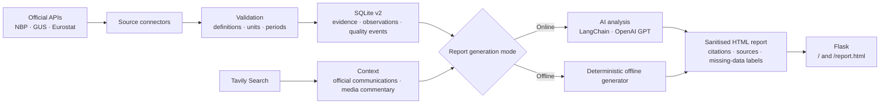
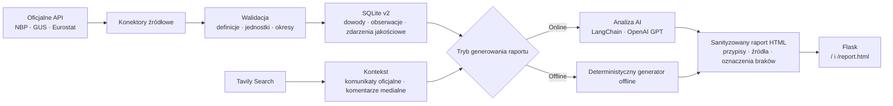

# Polish Economy Agent

[English](#english) · [Polski](#polski)

<a id="english"></a>

## English

### Overview

Polish Economy Agent is an engineering portfolio project that demonstrates an auditable pipeline for collecting, validating, storing, and presenting selected macroeconomic indicators for Poland. It combines official public-data APIs with web-search context and can generate a cited analytical report either through OpenAI GPT or through a deterministic offline generator.

The project is a local prototype, not a deployed production service, an official statistical publication, or financial advice.

### What it does

- collects selected exchange-rate, interest-rate, inflation, labour-market, and GDP observations from NBP, GUS, and Eurostat connectors;
- validates source payloads, indicator definitions, units, periods, and frequencies before persistence;
- stores observations in an auditable SQLite v2 schema with source evidence, quality events, versioning, and append-only protection;
- enriches the factual dataset with Tavily search results classified as official communications or media commentary;
- keeps registered unemployment, LFS/BAEL unemployment, CPI variants, and GDP growth definitions separate;
- generates a six-section report with numbered citations and explicit `Brak danych` / `No data` handling instead of invented values;
- renders escaped and sanitised HTML and serves the latest report through Flask;
- supports partial connector failures without silently replacing missing observations.

### Data flow



The official-data and Tavily paths are complementary. Numerical observations originate from the connector and validation path; search results provide separately labelled context and source evidence.

### Technology stack

| Technology | Role in the project |
|---|---|
| Python 3.11+ | Application, connectors, validation, orchestration, and reporting |
| Flask | Local HTML report server |
| SQLite v2 | Auditable persistence for runs, evidence, observations, quality events, and reports |
| NBP API | EUR/PLN and USD/PLN rates and the NBP reference rate |
| GUS API | Selected BDL and DBW indicators, including registered unemployment and CPI |
| Eurostat API | HICP, LFS/BAEL unemployment, and GDP series |
| Tavily | Optional online search context and source snippets |
| LangChain | Prompt, model, parser, and callback integration |
| OpenAI GPT (`gpt-4o`) | Optional online report model with streamed terminal output |
| pytest | Offline unit, security, connector, storage, migration, and pipeline tests |
| uv | Reproducible dependency and test runner workflow |

### Quick start: offline demo

The default mode is offline. It requires no API keys and does not call NBP, GUS, Eurostat, Tavily, or OpenAI. The pipeline uses deterministic local fixtures, writes only to the SQLite v2 database, generates `report.html`, and starts Flask locally.

> **Data notice:** offline fixture values are illustrative demonstration data. They are not live, current, or suitable for economic decisions.

Requirements: Python 3.11 or newer and `uv`.

```bash
git clone https://github.com/maciejkubek-maker/polish-economy-agent.git
cd polish-economy-agent
cp .env.example .env
uv sync --group dev
uv run python app.py
```

In PowerShell, use `Copy-Item .env.example .env` instead of `cp`. The copied file already contains `OFFLINE_MODE=true` and empty API keys.

Open <http://127.0.0.1:5000/> or <http://127.0.0.1:5000/report.html>. Stop the local server with `Ctrl+C`.

The application is offline by default even without `.env`, but copying the example makes the safe configuration explicit. Do not set `DB_V2_PATH` to `instance/economy_agent.db`; that legacy database is protected and must remain unchanged.

### Optional online mode

Online mode contacts external services and may create billable model or search requests depending on the configured accounts. Enable it only when you intend to use those services.

Copy the safe example to a local `.env` file that is not committed, then set `OFFLINE_MODE=false` and provide keys only for services you intend to use:

```bash
cp .env.example .env
# PowerShell: Copy-Item .env.example .env
```

```dotenv
OFFLINE_MODE=false
DB_V2_PATH=instance/economy_agent_v2.db

OPENAI_API_KEY=your_openai_key
TAVILY_API_KEY=your_tavily_key
```

Then run:

```bash
uv run python app.py
```

Online report generation uses OpenAI GPT through LangChain with the `gpt-4o` model and streams the analysis to the terminal. `OPENAI_API_KEY` is the only key required for AI analysis. Under the live pipeline, reports are generated strictly by GPT and validated against stored observations (exact numbers, footnote-to-source attribution, URLs, and section structure). The final section 6 bibliography is assembled programmatically from the verified citations registry with direct endpoint URLs, while GPT provides strict footnote markers `[N]` linked to verified official sources (web search snippets from Tavily are never treated as official statistical observations). If GPT fails or validation rejects the report, the run is marked `FAILED` without generating any deterministic substitute report, and no report is persisted to SQLite or `report.html`. The deterministic report generator is reserved exclusively for the intentional offline demo mode. Live official-data calls and Tavily context require network access. If Tavily is unavailable or returns no results, the live run is marked partial and continues without search context; offline fixtures are never substituted in live mode.

### Local diagnostics

Every pipeline execution writes secret-redacted diagnostics under `instance/logs/` (the directory is ignored by Git):

- `agent.log` is a rotating event and error log;
- `last_run.json` is a readable summary of the latest run, including its real pipeline status, GPT generation outcome, Tavily status, verified and missing indicators, and report ID.

The diagnostic files never intentionally store API keys, authorization headers, full prompts, or GPT responses. They remain local and can be removed when no longer needed without affecting SQLite data or generated reports.

### Tests

The final stabilization regression suite passes **154 tests** offline:

```bash
uv sync --group dev
uv run pytest -q
```

Expected audited result: `154 passed`.

<a id="report-screenshots"></a>

### Report screenshots

> **Screenshot placeholder 1:** full HTML report overview.

> **Screenshot placeholder 2:** source citations and evidence section.

No image links are included until the screenshots are added to the repository.

### Scope and limitations

- Coverage is intentionally limited to the indicators implemented by the current connectors.
- Release schedules differ, so one report can contain daily, monthly, quarterly, and annual periods.
- Search snippets are untrusted context, not authoritative numerical observations or instructions for the agent.
- LLM output is not treated as source data; reports are built from stored observations and evidence.
- The repository is a portfolio prototype and has no production deployment, scheduler, public API, dashboard, or interactive charts.
- See the [documentation index](docs/INDEX.md) for architecture, data-contract, migration, quality, and source-policy notes.

---

<a id="polski"></a>

## Polski

### O projekcie

Polish Economy Agent to projekt portfolio inżynierskiego prezentujący audytowalny potok pozyskiwania, walidacji, zapisu i prezentacji wybranych wskaźników makroekonomicznych dla Polski. Łączy oficjalne API danych publicznych z kontekstem wyszukiwania internetowego i generuje raport analityczny z przypisami za pomocą OpenAI GPT albo deterministycznego generatora offline.

Projekt jest lokalnym prototypem. Nie jest wdrożonym systemem produkcyjnym, oficjalną publikacją statystyczną ani poradą finansową.

### Funkcjonalności

- pobieranie wybranych kursów walut, stóp procentowych, danych o inflacji, rynku pracy i PKB przez konektory NBP, GUS i Eurostatu;
- walidacja odpowiedzi źródłowych, definicji wskaźników, jednostek, okresów i częstotliwości przed zapisem;
- audytowalny zapis w SQLite v2 z dowodami źródłowymi, zdarzeniami jakościowymi, wersjonowaniem i ochroną append-only;
- wzbogacanie danych o wyniki Tavily sklasyfikowane jako komunikaty oficjalne lub komentarze medialne;
- rozdzielenie m.in. bezrobocia rejestrowanego od BAEL, wariantów CPI oraz dynamiki PKB kw/kw od r/r;
- sześciosekcyjny raport z numerowanymi przypisami i jawnym oznaczeniem `Brak danych` zamiast zgadywania wartości;
- bezpieczne renderowanie HTML z escapowaniem i sanityzacją oraz udostępnianie raportu przez Flask;
- kontrolowana obsługa częściowych awarii konektorów.

### Przepływ danych



Ścieżki danych oficjalnych i Tavily wzajemnie się uzupełniają. Obserwacje liczbowe pochodzą z konektorów i walidacji, natomiast wyniki wyszukiwania dostarczają oddzielnie oznaczony kontekst i dowody źródłowe.

### Technologie

| Technologia | Rola w projekcie |
|---|---|
| Python 3.11+ | Aplikacja, konektory, walidacja, orkiestracja i raportowanie |
| Flask | Lokalny serwer raportu HTML |
| SQLite v2 | Audytowalny zapis przebiegów, dowodów, obserwacji, zdarzeń jakościowych i raportów |
| NBP API | Kursy EUR/PLN i USD/PLN oraz stopa referencyjna NBP |
| GUS API | Wybrane wskaźniki BDL i DBW, w tym bezrobocie rejestrowane i CPI |
| Eurostat API | HICP, bezrobocie BAEL i szeregi PKB |
| Tavily | Opcjonalny kontekst wyszukiwania online i wycinki źródłowe |
| LangChain | Integracja promptów, modeli, parserów i callbacków |
| OpenAI GPT (`gpt-4o`) | Opcjonalny model raportowania online ze streamingiem w terminalu |
| pytest | Testy offline: jednostkowe, bezpieczeństwa, konektorów, bazy, migracji i potoku |
| uv | Powtarzalna instalacja zależności i uruchamianie testów |

### Szybki start: demo offline

Tryb offline jest domyślny. Nie wymaga kluczy API i nie łączy się z NBP, GUS, Eurostatem, Tavily ani OpenAI. Potok korzysta z deterministycznych lokalnych fixture'ów, zapisuje dane wyłącznie w bazie SQLite v2, generuje `report.html` i uruchamia lokalny serwer Flask.

> **Informacja o danych:** wartości we fixture'ach offline są przykładowymi danymi demonstracyjnymi. Nie są danymi bieżącymi ani podstawą do decyzji ekonomicznych.

Wymagania: Python 3.11 lub nowszy oraz `uv`.

```bash
git clone https://github.com/maciejkubek-maker/polish-economy-agent.git
cd polish-economy-agent
cp .env.example .env
uv sync --group dev
uv run python app.py
```

W PowerShell zamiast `cp` użyj `Copy-Item .env.example .env`. Skopiowany plik ma już `OFFLINE_MODE=true` i puste klucze API.

Otwórz <http://127.0.0.1:5000/> lub <http://127.0.0.1:5000/report.html>. Zatrzymaj lokalny serwer skrótem `Ctrl+C`.

Aplikacja jest domyślnie offline również bez pliku `.env`, ale skopiowanie przykładu jawnie utrwala bezpieczną konfigurację. Nie ustawiaj `DB_V2_PATH` na `instance/economy_agent.db`; ta baza legacy jest chroniona i musi pozostać niezmieniona.

### Opcjonalny tryb online

Tryb online łączy się z usługami zewnętrznymi i zależnie od skonfigurowanych kont może powodować płatne wywołania modeli lub wyszukiwarki. Włączaj go wyłącznie świadomie.

Skopiuj bezpieczny przykład do lokalnego, niecommitowanego pliku `.env`, następnie ustaw `OFFLINE_MODE=false` i uzupełnij wyłącznie klucze usług, których zamierzasz użyć:

```bash
cp .env.example .env
# PowerShell: Copy-Item .env.example .env
```

```dotenv
OFFLINE_MODE=false
DB_V2_PATH=instance/economy_agent_v2.db

OPENAI_API_KEY=twoj_klucz_openai
TAVILY_API_KEY=twoj_klucz_tavily
```

Następnie uruchom:

```bash
uv run python app.py
```

Generowanie raportu online wykorzystuje OpenAI GPT przez LangChain, model `gpt-4o`, ze streamingiem analizy w terminalu. `OPENAI_API_KEY` jest jedynym kluczem wymaganym do analizy AI. W trybie live raport generuje wyłącznie GPT i musi on przejść rygorystyczną walidację (struktura 6 sekcji, spójność liczb, powiązanie przypisów z właściwymi źródłami i bezpośrednie linki URL). Końcowa sekcja 6 (bibliografia) jest składana programowo z oficjalnego rejestru cytowań z bezpośrednimi URL-ami, podczas gdy model odpowiada za rygorystyczne przypisy `[N]`, a wyniki wyszukiwania (Tavily) nigdy nie są traktowane jako oficjalne obserwacje statystyczne. Błąd API GPT lub odrzucenie przez walidator oznacza natychmiastowe niepowodzenie generowania (`pipeline_status=FAILED`, `report_id=null`) — potok live NIE tworzy raportu zastępczego ani nie zapisuje nieudanej próby do bazy SQLite i pliku `report.html`. Generator deterministyczny jest zarezerwowany WYŁĄCZNIE dla świadomego trybu offline. Pobieranie aktualnych danych oficjalnych i kontekstu Tavily wymaga dostępu do sieci. Jeśli Tavily jest niedostępne lub nie zwróci wyników, przebieg live otrzymuje status częściowy i działa bez kontekstu wyszukiwania; fixture'y offline nigdy nie są podstawiane w trybie live.

### Lokalna diagnostyka

Każde uruchomienie potoku zapisuje lokalną diagnostykę z redakcją sekretów w `instance/logs/` (katalog jest ignorowany przez Git):

- `agent.log` to rotowany dziennik zdarzeń i błędów;
- `last_run.json` to czytelne podsumowanie ostatniego przebiegu z rzeczywistym statusem potoku, wynikiem generowania GPT, statusem Tavily, listą zweryfikowanych i brakujących wskaźników oraz identyfikatorem raportu.

Pliki diagnostyczne nie zapisują celowo kluczy API, nagłówków autoryzacyjnych, pełnych promptów ani odpowiedzi GPT. Pozostają lokalne i można je usunąć bez wpływu na dane SQLite lub wygenerowane raporty.

### Testy

Zestaw regresyjny końcowej stabilizacji potwierdził **154 testy** działające offline:

```bash
uv sync --group dev
uv run pytest -q
```

Oczekiwany wynik audytu: `154 passed`.

### Zrzuty ekranu raportu

Dwa miejsca na przyszłe zrzuty znajdują się w [sekcji angielskiej](#report-screenshots): pełny widok raportu HTML oraz sekcja przypisów i dowodów źródłowych. Odnośniki do obrazów zostaną dodane dopiero po umieszczeniu zrzutów w repozytorium.

### Zakres i ograniczenia

- Zakres danych jest celowo ograniczony do wskaźników obsługiwanych przez obecne konektory.
- Terminy publikacji są różne, dlatego jeden raport może obejmować okresy dzienne, miesięczne, kwartalne i roczne.
- Wycinki wyszukiwania są niezaufanym kontekstem, a nie autorytatywnymi obserwacjami liczbowymi ani instrukcjami dla agenta.
- Wynik LLM nie jest traktowany jako dane źródłowe; raporty powstają na podstawie zapisanych obserwacji i dowodów.
- Repozytorium jest prototypem portfolio i nie zawiera wdrożenia produkcyjnego, harmonogramu, publicznego API, dashboardu ani interaktywnych wykresów.
- Szczegóły architektury, kontraktu danych, migracji, jakości i polityki źródeł znajdują się w [indeksie dokumentacji](docs/INDEX.md).
