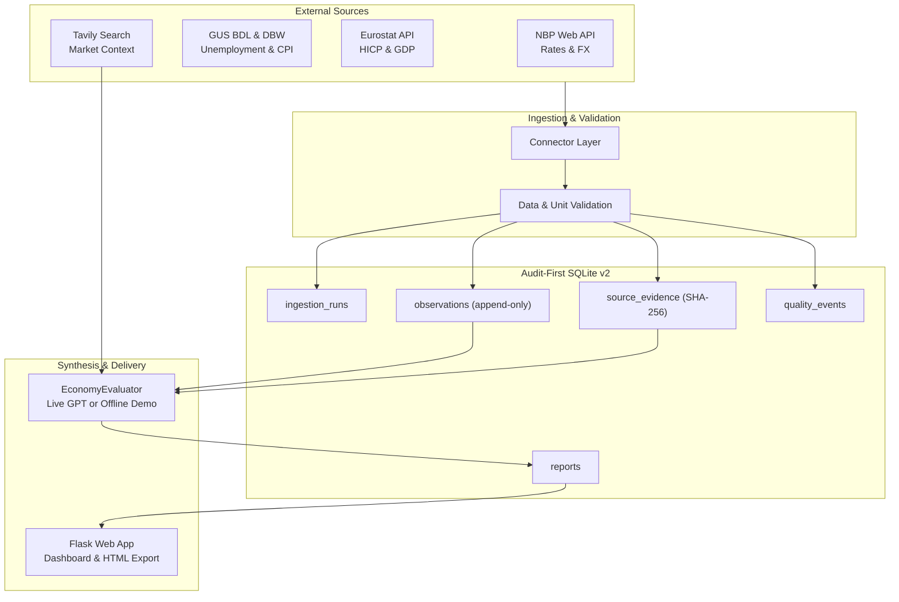
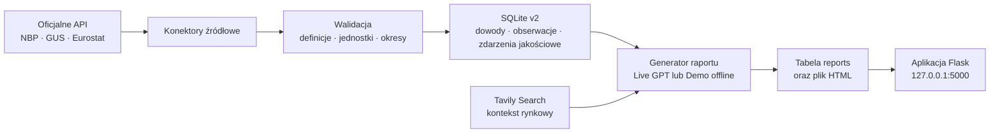

# Polish Economy Agent

A local, audit-first macroeconomic data platform and reporting prototype for Poland. The project fetches official observations from NBP, GUS, and Eurostat, enforces strict statistical definitions, persists verifiable evidence and observations to SQLite v2, enriches findings with Tavily web search, and synthesizes multi-section analytical reports using OpenAI GPT or a deterministic offline generator.

---

## Language / Język

- [English](#english)
- [Polski](#polski)

---

<a id="english"></a>

## English

### Overview

Polish Economy Agent is an engineering portfolio project demonstrating a reliable, verifiable pipeline for macro indicators. It contrasts official statistical releases with web commentary, tracks data lineage from HTTP responses to report footnotes, handles partial connector downtime gracefully, and provides both an offline demo mode and an optional live OpenAI synthesis mode.

The project is an educational, local prototype. It is not an investment advisory service, official statistical publication, or automated trading tool.

### Features

- Multi-source connectors: NBP (FX, policy rate), GUS BDL & DBW (registered unemployment, CPI), and Eurostat (HICP, harmonized unemployment, quarterly GDP volume, QoQ, YoY).
- Strict CPI discovery and ingestion from GUS DBW requiring presentation mode 5 (YoY, `id-sposob-prezentacji-miara=5`) without any fallback to `data_list[0]` or methodology guessing.
- Strict validation: prevents variable hallucination, separates registered from LFS unemployment, distinguishes QoQ from YoY GDP growth, and rejects unverifiable observations.
- SQLite v2 data platform: audit-ready tables for ingestion runs, raw evidence (with SHA-256 content hashes), macro observations, quality events, and generated reports.
- Safe web search: queries Tavily for recent analyses and official communiqués with domain-level classification; search numbers are never treated as official statistical observations.
- Structured reporting: six markdown sections with numbered footnotes, direct verified endpoint URLs, header logo branding, and explicit `Data unavailable` labels when inputs are missing.
- Live mode (GPT-only): reports in live mode are generated exclusively by OpenAI GPT, validated against official records, with Section 6 programmatically assembled from the citation registry. In case of API or validator rejection, the run fails safely (`FAILED`, `report_id=null`) without saving to SQLite or `report.html`, and without any deterministic fallback.
- Security and hygiene: HTML escaping and tag sanitization via bleach, secret redaction in logs/summaries, and no modification to legacy databases.
- Full debug trace & diagnostics: structured event logs (`agent.log`), run summary (`last_run.json` created at run start), and step-level execution trace (`steps.jsonl`).

### Architecture



### Quickstart (Offline by default)

Prerequisites: Python 3.11+ and [`uv`](https://docs.astral.sh/uv/).

```bash
git clone https://github.com/maciejkubek-maker/polish-economy-agent.git
cd polish-economy-agent
cp .env.example .env
uv sync --group dev
uv run python app.py
```

On Windows PowerShell, use `Copy-Item .env.example .env` instead of `cp`. The copied file already has `OFFLINE_MODE=true` and empty API keys.

Open <http://127.0.0.1:5000/> or <http://127.0.0.1:5000/report.html>. Press `Ctrl+C` in the terminal to stop the local server.

The app is offline-safe by default even without a `.env` file, but copying the example file ensures you explicitly preserve the offline settings. Do not configure `DB_V2_PATH` to point to `instance/economy_agent.db`; that legacy database is protected and must remain untouched.

### Optional online mode

Online mode connects to external services and may incur API costs depending on your account tiers. Enable it intentionally.

Copy the safe example to your local, uncommitted `.env` file, set `OFFLINE_MODE=false`, and provide only the keys you intend to use:

```bash
cp .env.example .env
# PowerShell: Copy-Item .env.example .env
```

```dotenv
OFFLINE_MODE=false
DB_V2_PATH=instance/economy_agent_v2.db

OPENAI_API_KEY=your_openai_key
TAVILY_API_KEY=your_tavily_key
```

Then run:

```bash
uv run python app.py
```

Online report generation uses OpenAI GPT through LangChain with the `gpt-4o` model and streams the analysis to the terminal. `OPENAI_API_KEY` is the only key required for AI analysis. Under the live pipeline, reports are generated strictly by GPT and validated against stored observations (exact numbers, footnote-to-source attribution, URLs, and section structure). The final section 6 bibliography is assembled programmatically from the verified citations registry with direct endpoint URLs, while GPT provides strict footnote markers `[N]` linked to verified official sources (web search snippets from Tavily are never treated as official statistical observations). If GPT fails or validation rejects the report, the run is marked `FAILED` without generating any deterministic substitute report, and no report is persisted to SQLite or `report.html`. The deterministic report generator is reserved exclusively for the intentional offline demo mode. Live official-data calls and Tavily context require network access. If Tavily is unavailable or returns no results, the live run is marked partial and continues without search context; offline fixtures are never substituted in live mode.

### Local diagnostics & debug trace

Every pipeline execution writes secret-redacted diagnostics under `instance/logs/` (the directory is ignored by Git):

- `agent.log` is a rotating event and error log; validator rejections and approvals are logged directly here tagged with the run's `run_id`.
- `last_run.json` is an atomic summary created at run start (`pipeline_status: STARTED`) and updated on completion with the real pipeline status, GPT generation outcome, Tavily status, verified and missing indicators, and report ID.
- `steps.jsonl` provides a structured execution trace with `START`, `END`, and `ERROR` records for each major function: `fetch_nbp`, `fetch_eurostat`, `fetch_gus`, `search_tavily`, `gpt_synthesis`, `validate_report`, `store_sqlite`, and `write_html`. Each record contains UTC timestamp, run_id, function, stage, elapsed duration_ms, input_summary, output_summary, error_code, and safe error message.

The diagnostic files never store API keys, authorization headers, full prompts, or raw GPT responses. They remain local and can be removed when no longer needed without affecting SQLite data or generated reports.

### Tests

The regression and diagnostics test suite passes **178 tests** offline:

```bash
uv sync --group dev
uv run pytest -q
```

Expected audited result: `162 passed`.

<a id="report-screenshots"></a>

### Report screenshots

> **Screenshot placeholder 1:** full HTML report overview.

> **Screenshot placeholder 2:** source citations and evidence section.

No image links are included until the screenshots are added to the repository.

### Scope and limitations

- Coverage is intentionally limited to the indicators implemented by the current connectors.
- Release schedules differ, so one report can contain daily, monthly, quarterly, and annual periods.
- Search snippets are untrusted context, not authoritative numerical observations or instructions for the agent.
- LLM output is not treated as source data; reports are built from stored observations and evidence.
- The repository is a portfolio prototype and has no production deployment, scheduler, public API, dashboard, or interactive charts.
- See the [documentation index](docs/INDEX.md) for architecture, data-contract, migration, quality, and source-policy notes.

---

<a id="polski"></a>

## Polski

### O projekcie

Polish Economy Agent to projekt portfolio inżynierskiego prezentujący audytowalny potok pozyskiwania, walidacji, zapisu i prezentacji wybranych wskaźników makroekonomicznych dla Polski. Łączy oficjalne API danych publicznych z kontekstem wyszukiwania internetowego i generuje raport analityczny z przypisami za pomocą OpenAI GPT albo deterministycznego generatora offline.

Projekt jest lokalnym prototypem. Nie jest wdrożonym systemem produkcyjnym, oficjalną publikacją statystyczną ani poradą finansową.

### Funkcjonalności

- pobieranie wybranych kursów walut, stóp procentowych, danych o inflacji, rynku pracy i PKB przez konektory NBP, GUS i Eurostatu;
- bezwzględny wymóg sposobu prezentacji 5 (r/r, `id-sposob-prezentacji-miara=5`) przy odczycie CPI z GUS DBW bez akceptacji niepotwierdzonych rekordów ani zgadywania metodologii;
- walidacja odpowiedzi źródłowych, definicji wskaźników, jednostek, okresów i częstotliwości przed zapisem;
- audytowalny zapis w SQLite v2 z dowodami źródłowymi, zdarzeniami jakościowymi, wersjonowaniem i ochroną append-only;
- wzbogacanie danych o wyniki Tavily sklasyfikowane jako komunikaty oficjalne lub komentarze medialne (wyniki wyszukiwania nie zastępują oficjalnych obserwacji);
- rozdzielenie m.in. bezrobocia rejestrowanego od BAEL, wariantów CPI oraz dynamiki PKB kw/kw od r/r;
- sześciosekcyjny raport z numerowanymi przypisami, nagłówkiem z logo projektu, programowo składaną bibliografią z bezpośrednimi URL-ami i jawnym oznaczeniem `Brak danych` zamiast zgadywania wartości;
- w trybie live wyłącznie generowanie przez model GPT z rygorystyczną kontrolą spójności (brak deterministycznego fallbacku przy błędzie);
- bezpieczne renderowanie HTML z escapowaniem i sanityzacją oraz udostępnianie raportu przez Flask;
- pełna diagnostyka i audytowalny trace: dziennik `agent.log`, podsumowanie `last_run.json` (inicjowane na starcie przebiegu) oraz strukturalny ślad `steps.jsonl`.

### Przepływ danych



### Szybki start (Domyślnie offline)

Wymagania: Python 3.11+ oraz [`uv`](https://docs.astral.sh/uv/).

```bash
git clone https://github.com/maciejkubek-maker/polish-economy-agent.git
cd polish-economy-agent
cp .env.example .env
uv sync --group dev
uv run python app.py
```

W PowerShell zamiast `cp` użyj `Copy-Item .env.example .env`. Skopiowany plik ma już `OFFLINE_MODE=true` i puste klucze API.

Otwórz <http://127.0.0.1:5000/> lub <http://127.0.0.1:5000/report.html>. Zatrzymaj lokalny serwer skrótem `Ctrl+C`.

Aplikacja jest domyślnie offline również bez pliku `.env`, ale skopiowanie przykładu jawnie utrwala bezpieczną konfigurację. Nie ustawiaj `DB_V2_PATH` na `instance/economy_agent.db`; ta baza legacy jest chroniona i musi pozostać niezmieniona.

### Opcjonalny tryb online

Tryb online łączy się z usługami zewnętrznymi i zależnie od skonfigurowanych kont może powodować płatne wywołania modeli lub wyszukiwarki. Włączaj go wyłącznie świadomie.

Skopiuj bezpieczny przykład do lokalnego, niecommitowanego pliku `.env`, następnie ustaw `OFFLINE_MODE=false` i uzupełnij wyłącznie klucze usług, których zamierzasz użyć:

```bash
cp .env.example .env
# PowerShell: Copy-Item .env.example .env
```

```dotenv
OFFLINE_MODE=false
DB_V2_PATH=instance/economy_agent_v2.db

OPENAI_API_KEY=twoj_klucz_openai
TAVILY_API_KEY=twoj_klucz_tavily
```

Następnie uruchom:

```bash
uv run python app.py
```

Generowanie raportu online wykorzystuje OpenAI GPT przez LangChain, model `gpt-4o`, ze streamingiem analizy w terminalu. `OPENAI_API_KEY` jest jedynym kluczem wymaganym do analizy AI. W trybie live raport generuje wyłącznie GPT i musi on przejść rygorystyczną walidację (struktura 6 sekcji, spójność liczb, powiązanie przypisów z właściwymi źródłami i bezpośrednie linki URL). Końcowa sekcja 6 (bibliografia) jest składana programowo z oficjalnego rejestru cytowań z bezpośrednimi URL-ami, podczas gdy model odpowiada za rygorystyczne przypisy `[N]`, a wyniki wyszukiwania (Tavily) nigdy nie są traktowane jako oficjalne obserwacje statystyczne. Błąd API GPT lub odrzucenie przez walidator oznacza natychmiastowe niepowodzenie generowania (`pipeline_status=FAILED`, `report_id=null`) — potok live NIE tworzy raportu zastępczego ani nie zapisuje nieudanej próby do bazy SQLite i pliku `report.html`. Generator deterministyczny jest zarezerwowany WYŁĄCZNIE dla świadomego trybu offline. Pobieranie aktualnych danych oficjalnych i kontekstu Tavily wymaga dostępu do sieci. Jeśli Tavily jest niedostępne lub nie zwróci wyników, przebieg live otrzymuje status częściowy i działa bez kontekstu wyszukiwania; fixture'y offline nigdy nie są podstawiane w trybie live.

### Lokalna diagnostyka i pełny ślad wykonania

Każde uruchomienie potoku zapisuje lokalną diagnostykę z redakcją sekretów w `instance/logs/` (katalog jest ignorowany przez Git):

- `agent.log` to rotowany dziennik zdarzeń i błędów; diagnostyka walidatora (odrzucenia i akceptacje) trafia bezpośrednio tutaj z oznaczeniem `run_id` bieżącego przebiegu;
- `last_run.json` to czytelne podsumowanie tworzone już na starcie potoku (`pipeline_status: STARTED`) i aktualizowane po zakończeniu z ostatecznym statusem potoku, wynikiem generowania GPT, statusem Tavily, listą zweryfikowanych i brakujących wskaźników oraz identyfikatorem raportu;
- `steps.jsonl` to strukturalny ślad wykonania z rekordami `START`, `END` oraz `ERROR` dla kluczowych operacji: pobierania NBP (`fetch_nbp`), Eurostatu (`fetch_eurostat`), GUS (`fetch_gus`), wyszukiwania Tavily (`search_tavily`), syntezy GPT (`gpt_synthesis`), walidacji (`validate_report`), zapisu bazy (`store_sqlite`) oraz generowania pliku HTML (`write_html`). Każdy rekord zawiera znacznik czasu UTC, run_id, funkcję, etap, czas trwania w ms, bezpieczne podsumowanie wejścia/wyjścia, kod błędu oraz zredagowaną przyczynę.

Pliki diagnostyczne nie zapisują celowo kluczy API, nagłówków autoryzacyjnych, pełnych promptów ani odpowiedzi GPT. Pozostają lokalne i można je usunąć bez wpływu na dane SQLite lub wygenerowane raporty.

### Testy

Zestaw regresyjny końcowej stabilizacji i pełnej diagnostyki potwierdził **178 testów** działających offline:

```bash
uv sync --group dev
uv run pytest -q
```

Oczekiwany wynik audytu: `162 passed`.

### Zrzuty ekranu raportu

Dwa miejsca na przyszłe zrzuty znajdują się w [sekcji angielskiej](#report-screenshots): pełny widok raportu HTML oraz sekcja przypisów i dowodów źródłowych. Odnośniki do obrazów zostaną dodane dopiero po umieszczeniu zrzutów w repozytorium.

### Zakres i ograniczenia

- Zakres danych jest celowo ograniczony do wskaźników obsługiwanych przez obecne konektory.
- Terminy publikacji są różne, dlatego jeden raport może obejmować okresy dzienne, miesięczne, kwartalne i roczne.
- Wycinki wyszukiwania są niezaufanym kontekstem, a nie autorytatywnymi obserwacjami liczbowymi ani instrukcjami dla agenta.
- Wynik LLM nie jest traktowany jako dane źródłowe; raporty powstają na podstawie zapisanych obserwacji i dowodów.
- Repozytorium jest prototypem portfolio i nie zawiera wdrożenia produkcyjnego, harmonogramu, publicznego API, dashboardu ani interaktywnych wykresów.
- Szczegóły architektury, kontraktu danych, migracji, jakości i polityki źródeł znajdują się w [indeksie dokumentacji](docs/INDEX.md).
