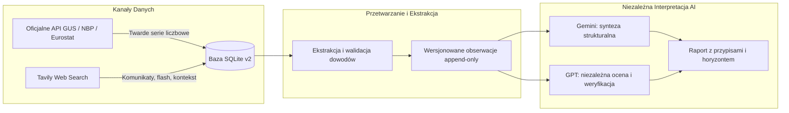

# Katalog Wskaźników Makroekonomicznych i Źródeł API (API Source Catalog)

**Status:** `PROPOSED` (katalog projektowy do wdrożenia w kolejnych etapach)  
**Dokument powiązany:** `tasks/TASK_03_SCHEMA_DESIGN.md`, `docs/SOURCE_POLICY.md`, `docs/ARCHITECTURE.md`  
**Data sporządzenia:** 2026-11-02  

---

## 1. Wstęp i Standard Weryfikacji Źródeł

Zgodnie z zasadą 8 i 12 `AGENTS.md` oraz wytycznymi `docs/SOURCE_POLICY.md`:
> *„Nie oznaczaj endpointów jako potwierdzonych bez ich weryfikacji. Nie zakładaj, że konkretne dane są dostępne w API bez potwierdzenia. Nigdy nie łącz różnych definicji ekonomicznych.”*

Wszystkie serie danych i źródła ujęte w niniejszym katalogu podlegają klasyfikacji według trzech poziomów dojrzałości technicznej:
- **`VERIFIED` (Potwierdzony):** Oficjalny endpoint REST, JSON-stat lub XML został zbadany, potwierdzony w dokumentacji technicznej i przetestowany pod kątem formatu oraz schematu parametrów.
- **`CONFIRMED_API_REQUIRES_VARIABLE_MAPPING` (API potwierdzone, wymaga zmapowania ID zmiennej):** Platforma API danej instytucji (np. GUS DBW lub BDL) funkcjonuje i posiada publiczny interfejs REST, lecz pobranie konkretnego wskaźnika wymaga odpytania słownika metadanych i powiązania dynamicznego identyfikatora zmiennej (`id-zmienna`, `var-id`).
- **`NOT_VERIFIED_REST_API` / `WEB_SEARCH_REQUIRED`:** Brak otwartego, bezpłatnego interfejsu REST dla danego wskaźnika. Dane są pozyskiwane z oficjalnych plików statycznych (XML/CSV) lub za pośrednictwem drugiego filaru architektury — **Tavily Web Search** i komunikatów instytucjonalnych.

---

## 2. Podsumowanie Wskaźników Pierwszego Wydania (Core MVP Scope)

Poniższa tabela stanowi bazę dla tabeli `indicator_catalog` w schemacie v2:

| Kod wskaźnika (`indicator_code`) | Oficjalna nazwa | Instytucja | Częstotliwość | Jednostka | Status API | Podstawowy mechanizm akwizycji |
|---|---|---|---|---|---|---|
| `PL_CPI_YOY` | Wskaźnik cen towarów i usług konsumpcyjnych (r/r) | GUS | Miesięczna | `PCT` | `CONFIRMED_API_REQUIRES_VARIABLE_MAPPING` | API DBW / SDP / dane.gov.pl + Tavily Flash |
| `PL_CPI_MOM` | Wskaźnik cen towarów i usług konsumpcyjnych (m/m) | GUS | Miesięczna | `PCT` | `CONFIRMED_API_REQUIRES_VARIABLE_MAPPING` | API DBW / SDP + Tavily |
| `PL_CORE_INFLATION_YOY` | Wskaźnik inflacji bazowej po wyłączeniu cen żywności i energii | NBP | Miesięczna | `PCT` | `NOT_VERIFIED_REST_API` | Komunikat prasowy NBP / Tavily Web Search |
| `PL_UNEMPLOYMENT_REGISTERED_RATE` | Stopa bezrobocia rejestrowanego | GUS | Miesięczna | `PCT` | `CONFIRMED_API_REQUIRES_VARIABLE_MAPPING` | API BDL (`var-id`) / API DBW |
| `PL_UNEMPLOYMENT_REGISTERED_COUNT` | Liczba bezrobotnych zarejestrowanych | GUS | Miesięczna | `THOUSAND_PERSONS` | `CONFIRMED_API_REQUIRES_VARIABLE_MAPPING` | API BDL / API DBW |
| `PL_UNEMPLOYMENT_LFS_RATE` | Stopa bezrobocia wg Badania Aktywności Ekonomicznej Ludności (BAEL) | GUS / Eurostat | Kwartalna | `PCT` | `VERIFIED` (Eurostat) | Eurostat API (`une_rt_q`) / GUS DBW |
| `PL_GDP_YOY` | Produkt Krajowy Brutto (ceny stałe, r/r) | GUS | Kwartalna | `PCT` | `CONFIRMED_API_REQUIRES_VARIABLE_MAPPING` | API DBW / dane.gov.pl + Tavily Flash |
| `PL_GDP_QOQ` | Produkt Krajowy Brutto (wyrównany sezonowo, kw/kw) | GUS / Eurostat | Kwartalna | `PCT` | `VERIFIED` (Eurostat) | Eurostat API (`namq_10_gdp`) / GUS DBW |
| `PL_WAGE_AVERAGE_GROSS` | Przeciętne miesięczne wynagrodzenie w sektorze przedsiębiorstw | GUS | Miesięczna | `PLN_PER_MONTH` | `CONFIRMED_API_REQUIRES_VARIABLE_MAPPING` | API DBW / dane.gov.pl |
| `PL_INDUSTRIAL_PRODUCTION_YOY` | Dynamika produkcji sprzedanej przemysłu (r/r) | GUS | Miesięczna | `PCT` | `CONFIRMED_API_REQUIRES_VARIABLE_MAPPING` | API DBW / dane.gov.pl |
| `PL_RETAIL_SALES_YOY` | Dynamika sprzedaży detalicznej w cenach stałych (r/r) | GUS | Miesięczna | `PCT` | `CONFIRMED_API_REQUIRES_VARIABLE_MAPPING` | API DBW / dane.gov.pl |
| `PL_CONSTRUCTION_PRODUCTION_YOY` | Dynamika produkcji budowlano-montażowej (r/r) | GUS | Miesięczna | `PCT` | `CONFIRMED_API_REQUIRES_VARIABLE_MAPPING` | API DBW / dane.gov.pl |
| `PL_NBP_REFERENCE_RATE` | Stopa referencyjna NBP | NBP | Nieregularna (posiedzenia RPP) | `PCT` | `VERIFIED` (Static XML) | Plik maszynowy XML `static.nbp.pl` |
| `PL_FX_EUR_PLN` | Kurs średni euro do złotego (Tabela A) | NBP | Dzienna (dni robocze) | `EUR_PLN` | `VERIFIED` | NBP Web API REST (`api.nbp.pl`) |
| `PL_FX_USD_PLN` | Kurs średni dolara amerykańskiego (Tabela A) | NBP | Dzienna (dni robocze) | `USD_PLN` | `VERIFIED` | NBP Web API REST (`api.nbp.pl`) |
| `PL_PMI_MANUFACTURING` | Indeks Menedżerów Logistyki PMI dla przemysłu | S&P Global | Miesięczna | `INDEX_POINTS` | `NOT_VERIFIED_REST_API` | Komunikat S&P Global / Tavily Web Search |
| `EU_HICP_YOY` | Harmonised Index of Consumer Prices (HICP) r/r | Eurostat | Miesięczna | `PCT` | `VERIFIED` | Eurostat Dissemination API 1.0 |
| `EU_UNEMPLOYMENT_RATE` | Harmonised Unemployment Rate (sezonowo wyrównana) | Eurostat | Miesięczna | `PCT` | `VERIFIED` | Eurostat Dissemination API 1.0 |
| `EU_GDP_YOY` | Real GDP Growth Rate (UE-27, r/r) | Eurostat | Kwartalna | `PCT` | `VERIFIED` | Eurostat Dissemination API 1.0 |

---

## 3. Szczegółowe Karty Wskaźników i Źródeł Technicznych

### 3.1. Narodowy Bank Polski (NBP)

#### A. Kursy Walut (EUR/PLN, USD/PLN)
- **Status API:** **`VERIFIED`** (W pełni publiczne, otwarte, darmowe, bez kluczy).
- **Architektura:** REST HTTP GET, format JSON.
- **Endpoint bazowy:** `https://api.nbp.pl/api/exchangerates/rates/A/{code}/?format=json`
- **Przykłady zapytań:**
  - Bieżący kurs EUR: `GET https://api.nbp.pl/api/exchangerates/rates/A/EUR/?format=json`
  - Bieżący kurs USD: `GET https://api.nbp.pl/api/exchangerates/rates/A/USD/?format=json`
  - Kurs z konkretnego dnia: `GET https://api.nbp.pl/api/exchangerates/rates/A/EUR/2026-03-06/?format=json`
  - Pełna Tabela A: `GET https://api.nbp.pl/api/exchangerates/tables/A/?format=json`
- **Cykl publikacji:** Każdy dzień roboczy między 11:45 a 12:15 CET.
- **Reguły walidacji:** Wartość dziesiętna w zakresie `1.0000 - 10.0000`, 4 miejsca po przecinku.

#### B. Stopy Procentowe NBP (`PL_NBP_REFERENCE_RATE`)
- **Status API:** **`VERIFIED_STATIC_XML`** (Brak endpointu w `api.nbp.pl`, oficjalny plik maszynowy XML).
- **Kluczowa uwaga architektoniczna:** Zgodnie z analizą źródłową `api.nbp.pl` obsługuje wyłącznie kursy walut i ceny złota. Stopy procentowe NBP udostępnia w statycznych strukturach XML aktualizowanych w dniu wejścia w życie uchwał RPP:
  - Aktualne stopy: `https://static.nbp.pl/dane/stopy/stopy_procentowe.xml`
  - Archiwum historyczne: `https://static.nbp.pl/dane/stopy/stopy_procentowe_archiwum.xml`
- **Struktura XML:** Zawiera węzły `<pozycja id="ref" obowiazuje_od="YYYY-MM-DD" oprocentowanie="X.XX"/>`.
- **Cykl publikacji:** Po posiedzeniach decyzyjnych Rady Polityki Pieniężnej (zazwyczaj raz w miesiącu).
- **Reguły walidacji:** Wartość dziesiętna w zakresie `0.00 - 30.00`, jednostka `PCT`.

#### C. Inflacja Bazowa NBP (`PL_CORE_INFLATION_YOY`)
- **Status API:** **`NOT_VERIFIED_REST_API`**.
- **Mechanizm akwizycji:** NBP publikuje 4 miary inflacji bazowej (m.in. po wyłączeniu cen żywności i energii) w oficjalnym komunikacie prasowym oraz pliku XLS/CSV ok. 16. dnia każdego miesiąca (po publikacji finalnego CPI przez GUS).
- **Rola Tavily Web Search:** Agent wyszukuje oficjalny komunikat Departamentu Statystyki NBP z danego miesiąca, a ekstraktor LLM pobiera wartość dla miary „po wyłączeniu cen żywności i energii”.

---

### 3.2. Główny Urząd Statystyczny (GUS)

GUS udostępnia dane przez portal [api.stat.gov.pl](https://api.stat.gov.pl) w kilku wyspecjalizowanych interfejsach:

#### A. Wskaźniki Cen Towarów i Usług Konsumpcyjnych (CPI r/r, CPI m/m)
- **Status API:** **`CONFIRMED_API_REQUIRES_VARIABLE_MAPPING`**.
- **Instytucja i portal:** Główny Urząd Statystyczny, interfejs **API DBW (Dziedzinowe Bazy Wiedzy)** oraz **API SDP**.
- **Endpoint bazowy DBW:** `https://api-dbw.stat.gov.pl/api/1.1.0/`
- **Metoda pobierania:**
  1. Identyfikacja przekroju wskaźników cen: `GET /area/area-area` (Obszar: Ceny).
  2. Pobranie danych dla zmiennej inflacji: `GET /data/data-data?id-zmienna={id_zmiennej}&id-okres={id_okresu}&id-rok={rok}`.
- **Alternatywa dane.gov.pl:** Zestaw `Wskaźniki makroekonomiczne GUS` pod `https://api.dane.gov.pl/1.4/resources/{resource_id}/data`.
- **Szybki szacunek (Flash estimate):** Publikowany w ostatnim dniu roboczym miesiąca w formie notatki sygnalnej PDF/HTML (nie w DBW w czasie rzeczywistym). Wymaga akwizycji przez **Tavily Web Search** i oznaczenia jako `revision_type = 'FLASH'`.
- **Raport finalny:** Publikowany ok. 15. dnia kolejnego miesiąca.

#### B. Rynek Pracy: Stopa Bezrobocia Rejestrowanego i Liczba Bezrobotnych
- **Status API:** **`CONFIRMED_API_REQUIRES_VARIABLE_MAPPING`**.
- **Interfejs podstawowy:** **API BDL (Bank Danych Lokalnych)**:
  - Adres bazowy: `https://bdl.stat.gov.pl/api/v1/`
  - Wyszukiwanie zmiennej bezrobocia: `GET /variables/search?name=bezrobocie&format=json`
  - Pobranie danych ogólnokrajowych: `GET /data/by-variable/{id}?unit-parent-id=000000000000&format=json`
- **Cykl publikacji:** Ok. 23–26. dnia kolejnego miesiąca.
- **Kluczowa zasada rozróżnienia:**
  - `PL_UNEMPLOYMENT_REGISTERED_RATE`: bezrobocie rejestrowane (liczba bezrobotnych w urzędach pracy do cywilnej ludności aktywnej zawodowo).
  - `PL_UNEMPLOYMENT_LFS_RATE`: bezrobocie wg BAEL (metodologia ILO/Eurostat, oparte na reprezentacyjnym badaniu ankietowym gospodarstw domowych). **Nigdy nie łączyć tych wskaźników!**

#### C. Produkt Krajowy Brutto (PKB r/r, kw/kw)
- **Status API:** **`CONFIRMED_API_REQUIRES_VARIABLE_MAPPING`** w GUS / **`VERIFIED`** w Eurostat.
- **Cykl publikacji GUS:**
  - Szybki szacunek (flash): ok. 45 dni po kwartale.
  - Szacunek wstępny (preliminary): ok. 60 dni po kwartale.
- **Rewizje:** PKB podlega regularnym rewizjom rocznym i kwartalnym. Zastosowanie schematu v2 (`revision_type`, `supersedes_id`) zapobiega zacieraniu historii rewizji.

#### D. Przeciętne Wynagrodzenie w Sektorze Przedsiębiorstw
- **Status API:** **`CONFIRMED_API_REQUIRES_VARIABLE_MAPPING`**.
- **Definicja:** Dotyczy przedsiębiorstw o liczbie pracujących powyżej 9 osób (nie obejmuje administracji publicznej, ochrony zdrowia, edukacji ani mikroprzedsiębiorstw).
- **Jednostka:** `PLN_PER_MONTH` (brutto).

---

### 3.3. Eurostat (Urząd Statystyczny Unii Europejskiej)

#### A. Statistics API 1.0 (JSON-stat 2.0)
- **Status API:** **`VERIFIED`** (Oficjalny, darmowy, otwarty, bez kluczy).
- **Adres bazowy:** `https://ec.europa.eu/eurostat/api/dissemination/statistics/1.0/data/{datasetCode}`
- **Format odpowiedzi:** JSON-stat 2.0 (parsowany deterministycznie w Pythonie za pomocą biblioteki `pyjstat` lub wbudowanego dekodera JSON).

#### Potwierdzone zestawy danych dla Polski i UE:
1. **HICP (Zharmonizowany wskaźnik cen konsumpcyjnych):**
   - Kod datasetu: `prc_hicp_manr` (roczna stopa zmian) lub `prc_hicp_midx` (indeks miesięczny).
   - Parametry: `format=JSON&lang=en&geo=PL&coicop=CP00`
2. **Stopa bezrobocia zharmonizowanego (LFS/BAEL):**
   - Kod datasetu: `une_rt_m`
   - Parametry: `format=JSON&lang=en&s_adj=SA&age=TOTAL&sex=T&unit=PC_ACT&geo=PL`
3. **Kwartalny PKB (Wzrost wolumenu łańcuchowego):**
   - Kod datasetu: `namq_10_gdp`
   - Parametry: `format=JSON&lang=en&na_item=B1GQ&s_adj=SCA&unit=CLV10_MEUR&geo=PL`

---

## 4. Architektura Równoległa: Rola Tavily Web Search, Gemini i GPT

Zgodnie z ADR-001 i ADR-002, integracja oficjalnych API nie zastępuje, lecz ściśle współpracuje z przeszukiwaniem internetu oraz modelami AI.

### 4.1. Zadania Tavily Web Search:
1. **Pozyskiwanie szybkich szacunków (Flash Estimates):** Zanim GUS wprowadzi dane do baz DBW/BDL, publikuje komunikat prasowy w formacie PDF/HTML. Tavily natychmiast przechwytuje komunikat w dniu publikacji.
2. **Wskaźniki bez darmowego API REST:** PMI dla przemysłu (S&P Global), inflacja bazowa NBP, wypowiedzi członków RPP.
3. **Kontekst makroekonomiczny:** Komentarze analityków, czynniki jednorazowe (tarcze energetyczne, zmiany podatkowe, wahania cen surowców).
4. **Bezpieczeństwo danych sieciowych:** Treści pozyskane z wyszukiwarki są traktowane jako **niezaufane dane wejściowe** (ochrona przed prompt injection). Nie stanowią instrukcji sterujących dla agentów.

### 4.2. Zadania Modeli Gemini i GPT:
1. **Gemini:** Ekstrakcja danych tabelarycznych z pobranych komunikatów HTML/PDF; generowanie ustrukturyzowanej interpretacji trendów; wyliczanie horyzontu wykonawczego.
2. **GPT:** Niezależna druga opinia analityczna (Dual-Agent Verification); krzyżowa weryfikacja wniosków; audyt spójności logicznej z danymi bazowymi.
3. **Rygor braku halucynacji:** Modele operują **wyłącznie** na obserwacjach dopuszczonych przez walidator ze statusem `VERIFIED` lub jawnie oznaczonych jako `PENDING`. Każda liczba w raporcie jest powiązana z unikalnym `evidence_id`.
