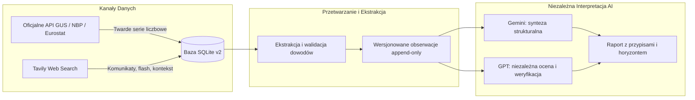

# Katalog Wskaźników Makroekonomicznych i Źródeł API (API Source Catalog)

**Status:** `PROPOSED` (katalog projektowy do wdrożenia w kolejnych etapach)  
**Dokument powiązany:** `tasks/TASK_03_SCHEMA_DESIGN.md`, `docs/SOURCE_POLICY.md`, `docs/ARCHITECTURE.md`  
**Data sporządzenia:** 2026-11-02 (Aktualizacja po code review)  

---

## 1. Wstęp i Standard Weryfikacji Źródeł

Zgodnie z zasadą 8 i 12 `AGENTS.md` oraz wytycznymi `docs/SOURCE_POLICY.md`:
> *„Nie oznaczaj endpointów jako potwierdzonych bez ich weryfikacji. Nie zakładaj, że konkretne dane są dostępne w API bez potwierdzenia. Nigdy nie łącz różnych definicji ekonomicznych.”*

Wszystkie serie danych i źródła ujęte w niniejszym katalogu podlegają klasyfikacji według czterech poziomów dojrzałości technicznej:
- **`VERIFIED` (Potwierdzony endpoint REST/JSON):** Oficjalny endpoint REST lub JSON-stat został zweryfikowany w dokumentacji technicznej i przetestowany pod kątem parametrów, schematu i jednostek.
- **`VERIFIED_STATIC_XML` (Potwierdzony plik maszynowy XML):** Oficjalne źródło maszynowe instytucji publicznej publikowane w strukturze XML, gdy dana instytucja nie udostępnia dedykowanego interfejsu REST.
- **`CONFIRMED_API_REQUIRES_VARIABLE_MAPPING` (API potwierdzone, wymaga zmapowania ID zmiennej):** Platforma API danej instytucji (np. GUS DBW lub BDL) funkcjonuje i posiada publiczny interfejs REST, lecz pobranie konkretnego wskaźnika wymaga odpytania słownika metadanych i powiązania dynamicznego identyfikatora zmiennej (`id-zmienna`, `var-id`).
- **`NOT_VERIFIED_REST_API` / `WEB_SEARCH_REQUIRED`:** Brak otwartego, bezpłatnego interfejsu REST dla danego wskaźnika. Dane są pozyskiwane za pośrednictwem drugiego filaru architektury — **Tavily Web Search** i oficjalnych komunikatów instytucjonalnych.

---

## 2. Podsumowanie Wskaźników Pierwszego Wydania (Core MVP Scope)

Poniższa tabela stanowi bazę dla tabeli `indicator_catalog` w schemacie v2:

| Kod wskaźnika (`indicator_code`) | Oficjalna nazwa | Instytucja | Częstotliwość | Jednostka | Status API | Podstawowy mechanizm akwizycji |
|---|---|---|---|---|---|---|
| `PL_CPI_YOY` | Wskaźnik cen towarów i usług konsumpcyjnych (r/r) | GUS | Miesięczna | `PCT` | `CONFIRMED_API_REQUIRES_VARIABLE_MAPPING` | API DBW / SDP / dane.gov.pl + Tavily Flash |
| `PL_CPI_MOM` | Wskaźnik cen towarów i usług konsumpcyjnych (m/m) | GUS | Miesięczna | `PCT` | `CONFIRMED_API_REQUIRES_VARIABLE_MAPPING` | API DBW / SDP + Tavily |
| `PL_CORE_INFLATION_YOY` | Wskaźnik inflacji bazowej po wyłączeniu cen żywności i energii | NBP | Miesięczna | `PCT` | `NOT_VERIFIED_REST_API` | Komunikat prasowy NBP / Tavily Web Search |
| `PL_UNEMPLOYMENT_REGISTERED_RATE` | Stopa bezrobocia rejestrowanego | GUS | Miesięczna | `PCT` | `CONFIRMED_API_REQUIRES_VARIABLE_MAPPING` | API BDL (`var-id`) / API DBW |
| `PL_UNEMPLOYMENT_REGISTERED_COUNT` | Liczba bezrobotnych zarejestrowanych | GUS | Miesięczna | `THOUSAND_PERSONS` | `CONFIRMED_API_REQUIRES_VARIABLE_MAPPING` | API BDL / API DBW |
| `PL_UNEMPLOYMENT_NEW_REGISTERED_COUNT`| Liczba nowo zarejestrowanych bezrobotnych (napływ) | GUS | Miesięczna | `THOUSAND_PERSONS` | `CONFIRMED_API_REQUIRES_VARIABLE_MAPPING` | API BDL / API DBW |
| `PL_UNEMPLOYMENT_LFS_RATE` | Stopa bezrobocia wg Badania Aktywności Ekonomicznej Ludności (BAEL) | GUS / Eurostat | Kwartalna | `PCT` | `VERIFIED` (Eurostat) | Eurostat API (`une_rt_q`) / GUS DBW |
| `PL_GDP_YOY` | Produkt Krajowy Brutto (ceny stałe, r/r) | GUS / Eurostat | Kwartalna | `PCT` | `VERIFIED` (Eurostat) / `CONFIRMED` (GUS) | Eurostat API (`namq_10_gdp`) / GUS DBW + Tavily Flash |
| `PL_GDP_QOQ` | Produkt Krajowy Brutto (wyrównany sezonowo, kw/kw) | GUS / Eurostat | Kwartalna | `PCT` | `VERIFIED` (Eurostat) / `CONFIRMED` (GUS) | Eurostat API (`namq_10_gdp`) / GUS DBW |
| `PL_WAGE_AVERAGE_GROSS` | Przeciętne miesięczne wynagrodzenie w sektorze przedsiębiorstw | GUS | Miesięczna | `PLN_PER_MONTH` | `CONFIRMED_API_REQUIRES_VARIABLE_MAPPING` | API DBW / dane.gov.pl |
| `PL_INDUSTRIAL_PRODUCTION_YOY` | Dynamika produkcji sprzedanej przemysłu (r/r) | GUS | Miesięczna | `PCT` | `CONFIRMED_API_REQUIRES_VARIABLE_MAPPING` | API DBW / dane.gov.pl |
| `PL_RETAIL_SALES_YOY` | Dynamika sprzedaży detalicznej w cenach stałych (r/r) | GUS | Miesięczna | `PCT` | `CONFIRMED_API_REQUIRES_VARIABLE_MAPPING` | API DBW / dane.gov.pl |
| `PL_CONSTRUCTION_PRODUCTION_YOY` | Dynamika produkcji budowlano-montażowej (r/r) | GUS | Miesięczna | `PCT` | `CONFIRMED_API_REQUIRES_VARIABLE_MAPPING` | API DBW / dane.gov.pl |
| `PL_NBP_REFERENCE_RATE` | Stopa referencyjna NBP | NBP | Nieregularna (posiedzenia RPP) | `PCT` | `VERIFIED_STATIC_XML` | Plik maszynowy XML `static.nbp.pl` |
| `PL_FX_EUR_PLN` | Kurs średni euro do złotego (Tabela A) | NBP | Dzienna (dni robocze) | `EUR_PLN` | `VERIFIED` | NBP Web API REST (`api.nbp.pl`) |
| `PL_FX_USD_PLN` | Kurs średni dolara amerykańskiego (Tabela A) | NBP | Dzienna (dni robocze) | `USD_PLN` | `VERIFIED` | NBP Web API REST (`api.nbp.pl`) |
| `PL_PMI_MANUFACTURING` | Indeks Menedżerów Logistyki PMI dla przemysłu | S&P Global | Miesięczna | `INDEX_POINTS` | `NOT_VERIFIED_REST_API` | Komunikat S&P Global / Tavily Web Search |
| `EU_HICP_YOY` | Harmonised Index of Consumer Prices (HICP) r/r | Eurostat | Miesięczna | `PCT` | `VERIFIED` | Eurostat Dissemination API 1.0 |
| `EU_UNEMPLOYMENT_RATE` | Harmonised Unemployment Rate (sezonowo wyrównana) | Eurostat | Miesięczna | `PCT` | `VERIFIED` | Eurostat Dissemination API 1.0 |
| `EU_GDP_YOY` | Real GDP Growth Rate (UE-27, r/r) | Eurostat | Kwartalna | `PCT` | `VERIFIED` | Eurostat Dissemination API 1.0 |

---

## 3. Szczegółowe Karty Wskaźników i Dowody Weryfikacji Technicznej

### 3.1. Narodowy Bank Polski (NBP)

#### A. Kursy Walut (EUR/PLN, USD/PLN)
- **Status API:** **`VERIFIED`** (W pełni publiczne, otwarte, darmowe, bez kluczy).
- **Architektura:** REST HTTP GET, format JSON.
- **Endpoint bazowy:** `https://api.nbp.pl/api/exchangerates/rates/A/{code}/?format=json`
- **Dowód odpowiedzi (Response Proof):**
  ```json
  {
    "table": "A",
    "currency": "euro",
    "code": "EUR",
    "rates": [
      {
        "no": "212/A/NBP/2026",
        "effectiveDate": "2026-10-30",
        "mid": 4.3955
      }
    ]
  }
  ```
- **Cykl publikacji:** Każdy dzień roboczy między 11:45 a 12:15 CET.
- **Jednostka:** `EUR_PLN`, `USD_PLN` (wartość w PLN za 1 jednostkę waluty obcej, 4 miejsca po przecinku).

#### B. Stopy Procentowe NBP (`PL_NBP_REFERENCE_RATE`)
- **Status API:** **`VERIFIED_STATIC_XML`** (Brak endpointu w `api.nbp.pl`, oficjalny plik maszynowy XML).
- **Dowód braku w REST API:** Próba zapytania pod adresem `https://api.nbp.pl/api/stopy/` lub `https://api.nbp.pl/api/interestrates/` zwraca błąd **HTTP 404 Not Found**. Oficjalna dokumentacja i specyfikacja Swagger dla `api.nbp.pl` obejmuje wyłącznie dwie gałęzie: `/exchangerates/` oraz `/cenyzlota/`.
- **Dowód oficjalnego źródła maszynowego (XML):** Narodowy Bank Polski publikuje aktualne i archiwalne stopy w plikach XML:
  - Aktualne stopy: `https://static.nbp.pl/dane/stopy/stopy_procentowe.xml`
  - Archiwum od 1998 r.: `https://static.nbp.pl/dane/stopy/stopy_procentowe_archiwum.xml`
- **Struktura pliku XML:**
  ```xml
  <stopy_procentowe>
      <pozycja id="ref" obowiazuje_od="2023-10-05" oprocentowanie="5.75"/>
      <pozycja id="lom" obowiazuje_od="2023-10-05" oprocentowanie="6.25"/>
      <pozycja id="dep" obowiazuje_od="2023-10-05" oprocentowanie="5.25"/>
      <pozycja id="red" obowiazuje_od="2023-10-05" oprocentowanie="5.80"/>
      <pozycja id="dys" obowiazuje_od="2023-10-05" oprocentowanie="5.85"/>
  </stopy_procentowe>
  ```
- **Cykl publikacji:** Po posiedzeniach decyzyjnych Rady Polityki Pieniężnej (zazwyczaj w pierwszą środę/czwartek miesiąca).
- **Jednostka:** `PCT` (stopa roczna w procentach, np. `5.75`).

#### C. Inflacja Bazowa NBP (`PL_CORE_INFLATION_YOY`)
- **Status API:** **`NOT_VERIFIED_REST_API`** (Brak darmowego endpointu REST).
- **Mechanizm akwizycji:** NBP publikuje 4 miary inflacji bazowej ok. 16. dnia każdego miesiąca (po publikacji finalnego CPI przez GUS). Wymaga akwizycji komunikatu przez **Tavily Web Search** i ekstrakcji wskaźnika „po wyłączeniu cen żywności i energii”.

---

### 3.2. Eurostat (Urząd Statystyczny Unii Europejskiej)

Eurostat udostępnia publiczne **Statistics API 1.0 (JSON-stat 2.0)** pod adresem bazowym:
`https://ec.europa.eu/eurostat/api/dissemination/statistics/1.0/data/{datasetCode}`

#### A. HICP — Zharmonizowany Wskaźnik Cen Konsumpcyjnych (`EU_HICP_YOY`)
- **Status API:** **`VERIFIED`**.
- **Kod datasetu:** `prc_hicp_manr` (Monthly rate of change).
- **Parametry zapytania:**
  `format=JSON&lang=en&geo=PL&coicop=CP00&sinceTimePeriod=2024M01`
  - `geo=PL` (Polska) lub `geo=EU27_2020` (Unia Europejska).
  - `coicop=CP00` (All-items HICP — wskaźnik ogólny).
- **Jednostka:** `PCT` (roczna stopa zmian w %, wymiar `unit=RCH_A`).
- **Dowód odpowiedzi (Response Proof):** Zwraca obiekt JSON-stat 2.0 z wymiarami `["unit", "coicop", "geo", "time"]` oraz wektorem wartości `value`.

#### B. Stopa Bezrobocia Zharmonizowanego wg BAEL (`PL_UNEMPLOYMENT_LFS_RATE` / `EU_UNEMPLOYMENT_RATE`)
- **Status API:** **`VERIFIED`**.
- **Kod datasetu:** `une_rt_m` (Unemployment by sex and age — monthly data).
- **Parametry zapytania:**
  `format=JSON&lang=en&s_adj=SA&age=TOTAL&sex=T&unit=PC_ACT&geo=PL&sinceTimePeriod=2024M01`
  - `s_adj=SA` (Seasonally adjusted — wyrównane sezonowo).
  - `age=TOTAL` (Wszyscy w wieku 15–74 lata).
  - `sex=T` (Total — kobiety i mężczyźni łącznie).
  - `unit=PC_ACT` (Percentage of active population).
- **Jednostka:** `PCT` (% ludności aktywnej zawodowo).
- **Różnica metodologiczna:** Wskaźnik ten bazuje na standardzie ILO i wynosi ok. 2,9%–3,2% dla Polski, podczas gdy stopa bezrobocia rejestrowanego GUS wynosi ok. 5,0%–5,8%. **Kategoryczny zakaz scalania obu serii!**

#### C. Kwartalny Wzrost PKB (`PL_GDP_QOQ` / `PL_GDP_YOY`)
- **Status API:** **`VERIFIED`**.
- **Kod datasetu:** `namq_10_gdp` (GDP and main components).
- **Parametry zapytania:**
  `format=JSON&lang=en&na_item=B1GQ&s_adj=SCA&unit=CLV10_MEUR&geo=PL&sinceTimePeriod=2023-Q1`
  - `na_item=B1GQ` (Gross Domestic Product at market prices).
  - `s_adj=SCA` (Seasonally and calendar adjusted).
  - `unit=CLV10_MEUR` (Chain linked volumes 2010 w mln euro) lub `unit=PCH_Q_PRE` (% zmiany kw/kw) / `unit=PCH_SM_PR_Y` (% zmiany r/r).
- **Jednostka:** `PCT` dla stóp wzrostu.

---

### 3.3. Główny Urząd Statystyczny (GUS)

GUS udostępnia dane przez portal [api.stat.gov.pl](https://api.stat.gov.pl) w kilku wyspecjalizowanych interfejsach:

#### A. Struktura API i Wyjaśnienie Statusu `CONFIRMED_API_REQUIRES_VARIABLE_MAPPING`
GUS nie udostępnia płaskiego słownika wskaźników makroekonomicznych, lecz strukturę hierarchiczną:
1. **API DBW (Dziedzinowe Bazy Wiedzy — `https://api-dbw.stat.gov.pl/api/1.1.0/`):**
   - Drzewo dziedzin: `GET /area/area-area` (Obszary tematyczne: Rynek pracy, Ceny, Finanse, Rachunki narodowe).
   - Przekroje: `GET /variable/variable-section-periods?id-przekroj={id_przekroju}`
   - Pobranie danych: `GET /data/data-data?id-zmienna={id_zmiennej}&id-okres={id_okresu}&id-rok={rok}`
2. **API BDL (Bank Danych Lokalnych — `https://bdl.stat.gov.pl/api/v1/`):**
   - Wyszukiwanie zmiennej: `GET /variables/search?name=bezrobocie&format=json`
   - Pobranie danych dla kraju: `GET /data/by-variable/{var_id}?unit-parent-id=000000000000&format=json`
3. **Portal Otwarte Dane (dane.gov.pl):**
   - Zestaw danych „Wskaźniki makroekonomiczne GUS”: `GET https://api.dane.gov.pl/1.4/resources/{resource_id}/data`
- **Dlaczego status to `REQUIRES_VARIABLE_MAPPING`:** Wskaźniki GUS podlegają corocznym aktualizacjom metodologicznym (np. coroczna zmiana koszyka wag CPI w marcu). Sztywne zakodowanie identyfikatorów bez mechanizmu discovery grozi awarią przy aktualizacji roku statystycznego.

#### B. Wskaźniki Cenowe (CPI r/r, CPI m/m)
- **Cykl publikacji:**
  - **Szybki szacunek (Flash estimate):** Ostatni dzień roboczy miesiąca (publikacja sygnalna na stronie GUS). Wymaga **Tavily Web Search** i oznaczenia `revision_type = 'FLASH'`.
  - **Raport finalny:** Ok. 15. dnia kolejnego miesiąca (publikacja w bazach DBW/SDP).
- **Jednostka:** `PCT` (np. `3.40%`).

#### C. Rynek Pracy (Bezrobocie rejestrowane i liczba bezrobotnych)
- **Częstotliwość:** Miesięczna (publikacja ok. 23–26. dnia kolejnego miesiąca).
- **Jednostki:**
  - `PL_UNEMPLOYMENT_REGISTERED_RATE`: `PCT` (np. `5.80%`).
  - `PL_UNEMPLOYMENT_REGISTERED_COUNT`: `THOUSAND_PERSONS` (np. `906.40 tys.`).
  - `PL_UNEMPLOYMENT_NEW_REGISTERED_COUNT`: `THOUSAND_PERSONS` (np. `93.00 tys.` — napływ do bezrobocia).

---

## 4. Architektura Równoległa: Rola Tavily Web Search, Gemini i GPT

Zgodnie z ADR-001 i ADR-002, integracja oficjalnych API nie zastępuje, lecz ściśle współpracuje z przeszukiwaniem internetu oraz modelami AI.



### 4.1. Zadania Tavily Web Search:
1. **Pozyskiwanie szybkich szacunków (Flash Estimates):** Zanim GUS wprowadzi dane do baz DBW/BDL, publikuje komunikat prasowy w formacie PDF/HTML. Tavily natychmiast przechwytuje komunikat w dniu publikacji.
2. **Wskaźniki bez darmowego API REST:** PMI dla przemysłu (S&P Global), inflacja bazowa NBP, wypowiedzi członków RPP.
3. **Kontekst makroekonomiczny:** Komentarze analityków, czynniki jednorazowe (tarcze energetyczne, zmiany podatkowe, wahania cen surowców).
4. **Bezpieczeństwo danych sieciowych:** Treści pozyskane z wyszukiwarki są traktowane jako **niezaufane dane wejściowe** (ochrona przed prompt injection). Nie stanowią instrukcji sterujących dla agentów.

### 4.2. Zadania Modeli Gemini i GPT:
1. **Gemini:** Ekstrakcja danych tabelarycznych z pobranych komunikatów HTML/PDF; generowanie ustrukturyzowanej interpretacji trendów; wyliczanie horyzontu wykonawczego.
2. **GPT:** Niezależna druga opinia analityczna (Dual-Agent Verification); krzyżowa weryfikacja wniosków; audyt spójności logicznej z danymi bazowymi.
3. **Rygor braku halucynacji:** Modele operują **wyłącznie** na obserwacjach dopuszczonych przez walidator ze statusem `VERIFIED` lub jawnie oznaczonych jako `PENDING`/`CONFLICT`. Każda liczba w raporcie jest powiązana z unikalnym `evidence_id`.
