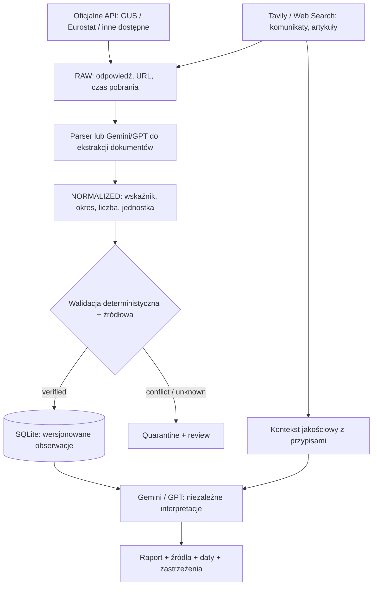

# Architektura docelowa — projekt do zatwierdzenia

## Cel
Wiarygodne wskaźniki ekonomiczne + interpretacja wieloagentowa + kontekst aktualnych publikacji. Baza SQLite jest mała; rozwiązanie nie wymaga obecnie infrastruktury lakehouse.

## Warstwy i obowiązki
- **Acquisition:** klient oficjalnego API; klient Tavily/Web Search; rate limits, retry i log błędów. Nie sugerować, że każda instytucja posiada API dla każdej serii (np. stopa referencyjna NBP wymaga sprawdzenia właściwego źródła danych).
- **RAW:** archiwum oryginalnej odpowiedzi, skrót/hash, metadane pobrania, URL i typ publikacji. Archiwizować zgodnie z uprawnieniami/licencją źródła; w razie ograniczeń tylko metadane i dozwolone fragmenty.
- **Extraction:** deterministyczny parser dla API; LLM dla dokumentów i komunikatów. Wynik ekstrakcji to kandydat na obserwację, nie fakt.
- **Normalization:** `indicator_code`, `country_code`, `frequency`, `period_start/end`, `value_decimal`, `unit_code`, `source_id`, opcjonalna `published_at`.
- **Validation:** jednostki, zakresy, dublowanie, właściwa definicja, znana częstotliwość, zgodność źródeł, okres i rewizja.
- **Persistence:** osobne tabele źródeł, definicji wskaźników, odczytów/rewizji, kandydatów z agentów, incydentów jakości i raportów.
- **Interpretation:** LLM nie nadpisuje danych; dostaje zatwierdzone odczyty oraz **oddzielnie oznaczony** kontekst wyszukiwania. Zwraca wnioski z odwołaniami do identyfikatorów dowodów.
- **Presentation:** HTML generowany bez wstrzykiwania treści niezaufanych. Każda liczba w raporcie ma źródło i okres; datę wygenerowania oddzielać od daty danych.

## Zachowania szczególne
- Gdy API nie działa: zapisz błąd, korzystaj z ostatniego zatwierdzonego odczytu **z widoczną datą**, a nowe wyniki web oznacz jako kandydatów.
- Gdy brak zgodności: status `CONFLICT`, zachowaj alternatywne odczyty, nie generuj jednoznacznego twierdzenia.
- Gdy dany wskaźnik jest spóźniony: nie mieszaj czasu pobrania z okresem statystycznym; specyficzna polityka świeżości dla wskaźnika.
- Gdy model nie działa: raport oparty na danych może nadal pokazać sekcje faktograficzne bez wymyślonej interpretacji.

## Zakres iteracji
Najpierw bezpieczeństwo, potem model danych, migracja, pozyskiwanie API oraz Tavily, walidacja, analiza i prezentacja. Nie wdrażać wszystkich warstw w jednym PR.