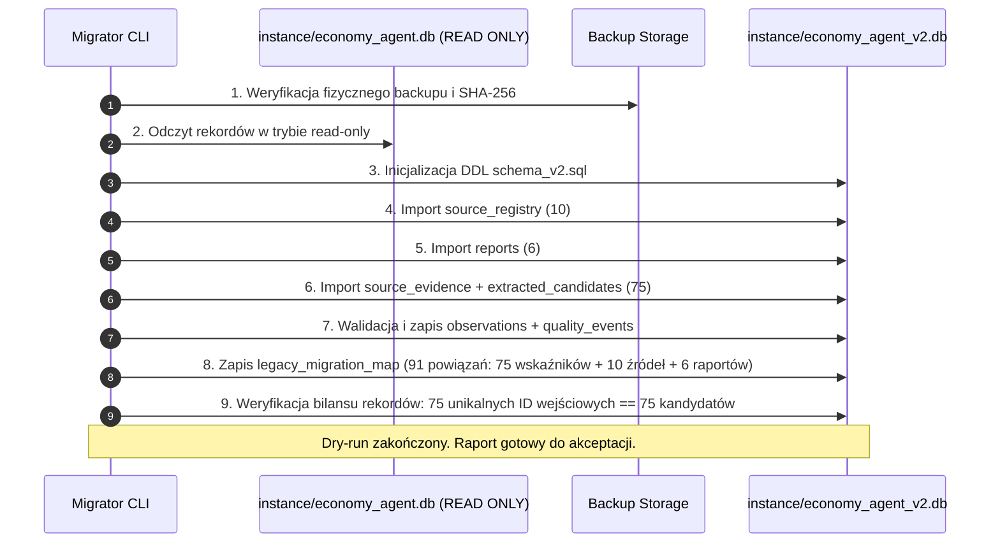

# Plan Bezstratnej Migracji Danych Legacy (Migration v2 Plan)

**Status:** `PROPOSED` (projekt procedury — **BEZ WYKONYWANIA MIGRACJI** na pliku produkcyjnym)  
**Dokument powiązany:** `tasks/TASK_03_SCHEMA_DESIGN.md`, `docs/MIGRATION.md`, `docs/BASELINE.md`  
**Data sporządzenia:** 2026-11-02 (Aktualizacja po code review)  

---

## 1. Cel i Główne Zasady Migracji

Celem niniejszego dokumentu jest zdefiniowanie kompletnej, deterministycznej i w 100% odwracalnej procedury migracji dotychczasowych danych z bazy `instance/economy_agent.db` do nowego modelu danych SQLite v2.

### Żelazne reguły:
1. **Zero Data Loss (Ani jeden rekord nie ginie):** Wszystkie 75 rekordów z `collected_indicators`, 10 rekordów z `trusted_sources` oraz 6 rekordów z `generated_reports` muszą zostać w całości przeniesione do warstwy dowodowej i kandydatów.
2. **Potwierdzenie 75 unikalnych legacy ID:** Baza zawiera dokładnie 75 rekordów w `collected_indicators` o ciągłych kluczach `id` od `1` do `75`. Wszystkie 75 ID muszą posiadać jawny wpis w tabeli `legacy_migration_map`.
3. **Brak bezpośrednich modyfikacji bazy źródłowej:** Plik `instance/economy_agent.db` jest traktowany jako baza archiwalna i otwierany wyłącznie w trybie `mode=ro`.
4. **Rozdzielenie danych pewnych od niepewnych (brak zgadywania):** Żadna wartość wieloznaczna lub potencjalnie błędna nie może zostać automatycznie „zgadnięta” jako fakt w tabeli `observations`. Trafia do tabeli `extracted_candidates` z powiązanym wpisem w `quality_events` ze statusem `MIGRATED_PENDING` lub `MIGRATED_CONFLICT`.
5. **Idempotencja i rollback:** Uruchomienie procedury powtórnie musi dać identyczny rezultat bez duplikowania danych. Wycofanie procedury (rollback) polega na usunięciu nowego pliku roboczego bazy.

---

## 2. Inwentaryzacja i Klasyfikacja 75 Rekordów `collected_indicators`

Baza bazowa zawiera dokładnie **75 unikalnych rekordów** w tabeli `collected_indicators` o identyfikatorach `1..75` (`GPTAgent`: 42 rekordy, `GeminiAgent`: 33 rekordy, kraj: `Polska`). Analiza wykazała występowanie 24 odrębnych wariantów nazw tekstowych, które podzielono na 3 spójne grupy analityczne:

### Podsumowanie bilansu grup:
- **Grupa 1 (Wskaźniki o jednoznacznym mapowaniu):** **51 rekordów**
- **Grupa 2 (Synonimy i uogólnienia po weryfikacji kontekstu):** **17 rekordów**
- **Grupa 3 (Przypadki sporne, konflikty i niejednoznaczności):** **7 rekordów**
- **Suma całkowita:** **51 + 17 + 7 = 75 rekordów** (100% pokrycia bazy).

---

### Grupa 1: Wskaźniki o jednoznacznym mapowaniu (51 rekordów)
Wskaźniki, których definicja, jednostka i okres nie budzą wątpliwości metodologicznych:

| Wariant nazwy legacy | Liczba | Identyfikatory Legacy ID | Proponowany `indicator_code` | Jednostka docelowa | Status migracji |
|---|---|---|---|---|---|
| `Stopa bezrobocia rejestrowanego` | 13 | 1, 27, 29, 39, 41, 42, 53, 54, 55, 56, 57, 72, 74 | `PL_UNEMPLOYMENT_REGISTERED_RATE` | `PCT` | `MIGRATED_VERIFIED` |
| `Liczba zarejestrowanych bezrobotnych` | 9 | 40, 43, 47, 50, 67, 70, 71, 73, 75 | `PL_UNEMPLOYMENT_REGISTERED_COUNT` | `THOUSAND_PERSONS` | `MIGRATED_VERIFIED` |
| `Inflacja CPI r/r` | 8 | 2, 7, 21, 31, 37, 44, 52, 68 | `PL_CPI_YOY` | `PCT` | `MIGRATED_VERIFIED` |
| `Stopa bezrobocia rejestrowanego (GUS)` | 6 | 59, 60, 61, 62, 63, 66 | `PL_UNEMPLOYMENT_REGISTERED_RATE` | `PCT` | `MIGRATED_VERIFIED` |
| `Produkcja przemysłowa r/r` | 3 | 5, 11, 23 | `PL_INDUSTRIAL_PRODUCTION_YOY` | `PCT` | `MIGRATED_VERIFIED` |
| `Przeciętne wynagrodzenia` | 2 | 10, 17 | `PL_WAGE_AVERAGE_GROSS` | `PLN_PER_MONTH` | `MIGRATED_VERIFIED` |
| `Przeciętne Wynagrodzenia` | 1 | 22 | `PL_WAGE_AVERAGE_GROSS` | `PLN_PER_MONTH` | `MIGRATED_VERIFIED` |
| `Produkcja budowlano-montażowa r/r` | 2 | 12, 19 | `PL_CONSTRUCTION_PRODUCTION_YOY` | `PCT` | `MIGRATED_VERIFIED` |
| `Sprzedaż detaliczna r/r` | 2 | 13, 25 | `PL_RETAIL_SALES_YOY` | `PCT` | `MIGRATED_VERIFIED` |
| `Inflacja CPI m/m` | 1 | 24 | `PL_CPI_MOM` | `PCT` | `MIGRATED_VERIFIED` |
| `Inflacja m/m` | 1 | 15 | `PL_CPI_MOM` | `PCT` | `MIGRATED_VERIFIED` |
| `Produkt Krajowy Brutto kw/kw` | 1 | 16 | `PL_GDP_QOQ` | `PCT` | `MIGRATED_VERIFIED` |
| `Stopa referencyjna NBP` | 1 | 4 | `PL_NBP_REFERENCE_RATE` | `PCT` | `MIGRATED_VERIFIED` |
| `Purchasing Managers' Index (PMI) Polska` | 1 | 26 | `PL_PMI_MANUFACTURING` | `INDEX_POINTS` | `MIGRATED_VERIFIED` |
| **Razem Grupa 1** | **51** | **(51 unikalnych ID)** | | | |

---

### Grupa 2: Synonimy i uogólnienia po weryfikacji kontekstu (17 rekordów)
Wpisy, w których nazwa ogólna w rzeczywistości reprezentuje wskaźnik rejestrowany lub tożsamą inflację bazową:

| Wariant nazwy legacy | Liczba | Identyfikatory Legacy ID | Kontekst wartości i źródła | Proponowany `indicator_code` | Status migracji |
|---|---|---|---|---|---|
| `Stopa bezrobocia` | 7 | 6, 14, 20, 46, 48, 49, 51 | Wartości (5,8%, 6,1%, 5,6%, 6,0%), źródło GUS/Bankier. Dotyczy bezrobocia rejestrowanego, a nie BAEL. | `PL_UNEMPLOYMENT_REGISTERED_RATE` | `MIGRATED_VERIFIED` |
| `Liczba bezrobotnych` | 4 | 28, 30, 34, 36 | Wartości (956,2 tys., 906,4 tys.), źródło GUS. Odpowiada liczbie bezrobotnych zarejestrowanych. | `PL_UNEMPLOYMENT_REGISTERED_COUNT` | `MIGRATED_VERIFIED` |
| `Bezrobotni zarejestrowani` | 2 | 9, 18 | Wartość 906,40 tys. za VII 2026. Synonim liczby zarejestrowanych. | `PL_UNEMPLOYMENT_REGISTERED_COUNT` | `MIGRATED_VERIFIED` |
| `Inflacja bazowa (wyłączenie cen żywności i energii)` | 2 | 45, 58 | Wartość 3,1% za VII 2026, źródło NBP. Tożsamy wskaźnik. | `PL_CORE_INFLATION_YOY` | `MIGRATED_VERIFIED` |
| `Inflacja bazowa (z wyłączeniem cen żywności i energii)` | 1 | 64 | Wartość 3,1% za VII 2026, źródło NBP. Tożsamy wskaźnik. | `PL_CORE_INFLATION_YOY` | `MIGRATED_VERIFIED` |
| `Inflacja bazowa (po wyłączeniu cen żywności i energii)` | 1 | 69 | Wartość 3,1% za VII 2026, źródło NBP. Tożsamy wskaźnik. | `PL_CORE_INFLATION_YOY` | `MIGRATED_VERIFIED` |
| **Razem Grupa 2** | **17** | **(17 unikalnych ID)** | | | |

---

### Grupa 3: Przypadki sporne, konflikty i niejednoznaczności (7 rekordów)
Wymagają utworzenia zdarzenia w `quality_events` i statusu `MIGRATED_PENDING` lub `MIGRATED_CONFLICT`:

1. **Konflikt szacunku PKB r/r za II kw. 2026 (4 rekordy):**
   - Rekordy 3 i 8 (`Produkt Krajowy Brutto r/r`): wartość `3,90%`, źródło Bankier.pl / GUS.
   - Rekordy 32 i 38 (`PKB r/r`): wartość `3,8%`, źródło Główny Urząd Statystyczny (GUS).
   - **Poprawka po code review:** **Nie wolno arbitralnie zakładać, że 3,8% jest nowszą rewizją niż 3,90%** bez potwierdzonego źródłowo znacznika czasu publikacji (release vintage bulletin).
   - **Postępowanie:** Wszystkie 4 rekordy zostają zachowane w `extracted_candidates`. W tabeli `observations` (lub kwarantannie) oba odczyty otrzymują status `CONFLICT` (z powiązaniem w `quality_events` o kodzie `RULE_SOURCE_DISCREPANCY`), dopóki człowiek lub potwierdzona metadana źródłowa nie rozstrzygnie relacji rewizyjnej. Status migracji w mapie: `MIGRATED_CONFLICT`.
2. **Błędna etykieta „r/r” dla poziomu stopy bezrobocia (2 rekordy):**
   - Rekordy 33 i 35 (`Stopa bezrobocia r/r`): wartości `6,1%` (luty 2026) oraz `5,8%` (lipiec 2026), zgłoszone przez `GPTAgent`.
   - **Diagnoza:** Agent błędnie dodał przyrostek "r/r" do stopy rejestrowanej, która jest wskaźnikiem poziomu, a nie dynamiki.
   - **Postępowanie:** Zapisanie w `extracted_candidates` z flagą `MIGRATED_PENDING`, wpis w `quality_events` (`RULE_MISLABELED_INDICATOR_NAME`).
3. **Odrębny wskaźnik strumienia: nowo zarejestrowani bezrobotni (1 rekord):**
   - Rekord 65 (`Liczba nowo zarejestrowanych bezrobotnych`): wartość `93,0 tys.` za XI 2025.
   - **Diagnoza:** Jest to napływ do bezrobocia (flow), a nie stan zasobu bezrobotnych (stock). Próba scalenia z liczbą ogólną bezrobotnych sfałszowałaby dane o rząd wielkości.
   - **Postępowanie:** Przypisanie dedykowanego kodu `PL_UNEMPLOYMENT_NEW_REGISTERED_COUNT`, status `MIGRATED_VERIFIED`.
- **Razem Grupa 3:** **7 rekordów** (IDs: 3, 8, 32, 33, 35, 38, 65).

---

## 3. Plan Mapowania Tabel `trusted_sources` i `generated_reports`

### 3.1. `trusted_sources` (10 rekordów) -> `source_registry`
Wszystkie 10 oficjalnych domen i portali zostaje bezstratnie przeniesionych do `source_registry`:
- `Główny Urząd Statystyczny (GUS)` -> `SRC_GUS` (TIER_A)
- `Narodowy Bank Polski (NBP)` -> `SRC_NBP` (TIER_A)
- `Ministerstwo Finansów` -> `SRC_MF` (TIER_A)
- `Eurostat` -> `SRC_EUROSTAT` (TIER_A)
- `Międzynarodowy Fundusz Walutowy (IMF)` -> `SRC_IMF` (TIER_A)
- `OECD` -> `SRC_OECD` (TIER_A)
- `Komisja Europejska` -> `SRC_EC` (TIER_A)
- `Bank Światowy` -> `SRC_WB` (TIER_A)
- `Polski Instytut Ekonomiczny (PIE)` -> `SRC_PIE` (TIER_B)
- `Giełda Papierów Wartościowych w Warszawie (GPW)` -> `SRC_GPW` (TIER_B)

### 3.2. `generated_reports` (6 rekordów) -> `reports`
- Każdy z 6 historycznych raportów zostaje zapisany z zachowaniem oryginalnego `content_markdown`.
- Wyliczony zostaje `data_snapshot_hash` na podstawie powiązanych obserwacji.
- `as_of_utc` zostaje zmapowany z kolumny `created_at` (18.09.2026).
- Raporty w tabeli legacy otrzymują wpis w `legacy_migration_map` z mapowaniem `legacy_id -> report_id`.

---

## 4. Parser Formatów Wartości i Okresów

Dla każdego rekordu parser wykonuje następujące operacje w sposób w 100% zdeterminowany:

### 4.1. Normalizacja wartości liczbowej:
```python
# Przykłady przekształceń:
"5,80%"           -> value_decimal = "5.80",   unit_code = "PCT"
"-2,40%"          -> value_decimal = "-2.40",  unit_code = "PCT"
"906,40 tys."     -> value_decimal = "906.40", unit_code = "THOUSAND_PERSONS"
"9233,13 zł"      -> value_decimal = "9233.13",unit_code = "PLN_PER_MONTH"
"48,30 pkt"       -> value_decimal = "48.30",  unit_code = "INDEX_POINTS"
```

### 4.2. Rozwiązywanie okresów statystycznych:
```python
# Format rzymski z rokiem:
"VII 2026"        -> period_start = "2026-07-01", period_end = "2026-07-31", frequency = "MONTHLY"
# Format słowny z rokiem:
"lipiec 2026"     -> period_start = "2026-07-01", period_end = "2026-07-31", frequency = "MONTHLY"
# Format kwartalny:
"II kw. 2026"     -> period_start = "2026-04-01", period_end = "2026-06-30", frequency = "QUARTERLY"
# Formaty niejednoznaczne (np. "II 2026", "IV 2026"):
# Weryfikowane po częstotliwości wskaźnika: dla CPI/bezrobocia -> miesiąc; dla PKB bez słowa "kw." -> flaga PENDING.
```

---

## 5. Procedura Wykonawcza Krok po Kroku (Dry-Run i Cutover)



### 5.1. Weryfikacja Idempotencji Pełnego Potoku (Full Pipeline Idempotency)
Zgodnie z wymogami projektu, ponowne uruchomienie całego procesu migracji (dla wszystkich 75 wskaźników, 10 źródeł i 6 raportów) na tej samej bazie docelowej nie tworzy żadnych nowych rekordów ani powiązań. Zastosowanie klauzul `ON CONFLICT DO NOTHING` gwarantuje, że:
- `source_registry`: niezmiennie 10 rekordów,
- `reports`: niezmiennie 6 rekordów,
- `source_evidence`: niezmiennie 75 rekordów,
- `extracted_candidates`: niezmiennie 75 rekordów,
- `quality_events`: niezmiennie 6 rekordów (4 dla rozbieżności PKB + 2 dla błędnej etykiety r/r w bezrobociu),
- `legacy_migration_map`: niezmiennie 91 wierszy powiązań.

Idempotencja jest w 100% testowalna i weryfikowana automatycznym testem `test_dry_run_migration_idempotency`.

### 5.2. Plan Wycofania (Rollback):
W przypadku jakichkolwiek problemów podczas testów migracji, baza docelowa jest kasowana. Plik `instance/economy_agent.db` nie ulega zmianie w żadnej fazie procesu.
