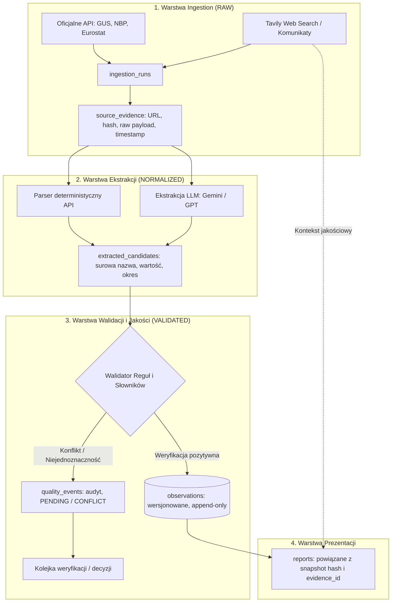
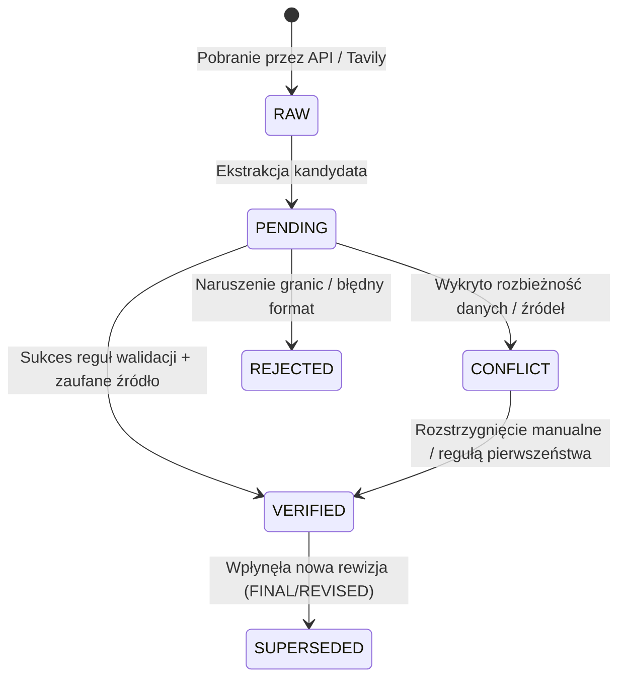

# Projekt Schematu Danych SQLite v2 (Data Contract Proposal)

**Status:** `PROPOSED` (do zatwierdzenia przez właściciela)  
**Dokument powiązany:** `tasks/TASK_03_SCHEMA_DESIGN.md`, `docs/DATA_CONTRACT.md`, `docs/ARCHITECTURE.md`  
**DDL demonstracyjny:** [`docs/sql/schema_v2.sql`](file:///E:/Programy/PycharmProjects/polish-economy-agent/docs/sql/schema_v2.sql)  
**Data sporządzenia:** 2026-11-02  

---

## 1. Diagnoza Problemów Modelu Legacy (v1)

W dotychczasowym schemacie tabela `collected_indicators` charakteryzowała się szeregiem ograniczeń strukturalnych i ryzyk integralności:
1. **Destrukcyjna aktualizacja in-place (`UPDATE`):** Metoda `save_indicators` wykonywała `UPDATE` na wierszu o dopasowanym kluczu `(agent_name, country, indicator_name, period)`. Uniemożliwiało to śledzenie rewizji danych (np. szacunek wstępny / flash vs dane ostateczne GUS) oraz zacierało historię odczytów.
2. **Wszystkie wartości jako typ `TEXT`:** Wartości (`value`, `previous_value`) były zapisywane z surowymi formatami prezentacyjnymi (np. `"5,80%"`, `"906,40 tys."`, `"9233,13 zł/miesiąc"`), co uniemożliwiało agregacje numeryczne, wykrywanie anomalii i walidację zakresów.
3. **Niejednoznaczność okresów:** Okresy statystyczne zapisywano w dowolnych formatach tekstowych (`"VII 2026"`, `"lipiec 2026"`, `"II 2026"`, `"II kw. 2026"`). Rzymska notacja `"II 2026"` była podatna na mylenie lutego z II kwartałem, a brak roku czterocyfrowego uniemożliwiał automatyczne sortowanie.
4. **Chaos semantyczny i brak kanonicznych kodów:** Brak centralnego katalogu prowadził do współistnienia 24 wariantów nazw dla kilkunastu pojęć ekonomicznych (np. 3 warianty inflacji bazowej, wielkości liter w wynagrodzeniach, niebezpieczne aliasy mylące napływ bezrobotnych z ich zasobem).
5. **Brak rozróżnienia etapów przetwarzania danych (RAW vs NORMALIZED vs VALIDATED):** Odpowiedź agenta LLM lub scrapera trafiała bezpośrednio do bazy jako fakt, bez rejestracji dowodu źródłowego, hasha treści, ani statusu walidacji.

---

## 2. Architektura Przepływu Danych w Modelu v2

Nowy schemat wprowadza rygorystyczny podział na trzy warstwy integralności:



---

## 3. Szczegółowy Słownik Tabel i Kolumn (DDL Dictionary)

Pełny, testowalny skrypt DDL znajduje się w [`docs/sql/schema_v2.sql`](file:///E:/Programy/PycharmProjects/polish-economy-agent/docs/sql/schema_v2.sql).

### 3.1. `source_registry` — Rejestr Źródeł Danych
Rejestruje instytucje, bazy danych oraz interfejsy wraz z poziomem zaufania (`trust_tier`).

| Kolumna | Typ SQLite | Ograniczenia | Opis |
|---|---|---|---|
| `source_id` | `TEXT` | `PRIMARY KEY` | Stabilny identyfikator, np. `SRC_GUS_DBW`, `SRC_NBP_STATIC`, `SRC_EUROSTAT`. |
| `name` | `TEXT` | `NOT NULL` | Pełna nazwa źródła / serwisu. |
| `institution` | `TEXT` | `NOT NULL` | Instytucja macierzysta (np. GUS, NBP, Eurostat). |
| `base_url` | `TEXT` | `NOT NULL` | URL bazowy usługi lub portalu. |
| `source_type` | `TEXT` | `NOT NULL`, `CHECK(...)` | Typ: `API_REST`, `API_SDMX`, `STATIC_XML`, `STATIC_HTML`, `WEB_SEARCH`, `MANUAL_ENTRY`. |
| `trust_tier` | `TEXT` | `NOT NULL`, `CHECK(...)` | Klasyfikacja wiarygodności: `TIER_A`, `TIER_B`, `TIER_C`, `TIER_D` (wg `SOURCE_POLICY.md`). |
| `auth_type` | `TEXT` | `NOT NULL DEFAULT 'NONE'` | Wymóg uwierzytelnienia: `NONE`, `API_KEY_HEADER`, `BEARER_TOKEN`, `QUERY_PARAM`. |
| `rate_limit_info` | `TEXT` | `NULLABLE` | Limity zapytań (np. `5 req/s, 100 req/15min`). |
| `documentation_url` | `TEXT` | `NULLABLE` | Odnośnik do oficjalnej dokumentacji technicznej. |
| `created_at_utc` | `TIMESTAMP`| `DEFAULT CURRENT_TIMESTAMP` | Data rejestracji źródła w UTC. |

### 3.2. `indicator_catalog` — Katalog Definicji Wskaźników
Sercem modelu jest kanoniczny katalog wskaźników makroekonomicznych. Kod wskaźnika (`indicator_code`) jest niezmiennym kluczem sztucznym rozdzielającym pojęcia ekonomiczne.

| Kolumna | Typ SQLite | Ograniczenia | Opis |
|---|---|---|---|
| `indicator_code` | `TEXT` | `PRIMARY KEY` | Unikalny kod, np. `PL_CPI_YOY`, `PL_UNEMPLOYMENT_REGISTERED_RATE`. |
| `name_pl` | `TEXT` | `NOT NULL` | Oficjalna polska nazwa wskaźnika. |
| `name_en` | `TEXT` | `NULLABLE` | Międzynarodowa nazwa wskaźnika. |
| `definition_pl` | `TEXT` | `NOT NULL` | Ścisła definicja metodologiczna. |
| `methodology_notes` | `TEXT` | `NULLABLE` | Informacje o koszyku, metodzie estymacji, rewizjach rocznych itp. |
| `frequency` | `TEXT` | `NOT NULL`, `CHECK(...)` | Częstotliwość publikacji: `DAILY`, `MONTHLY`, `QUARTERLY`, `ANNUAL`, `IRREGULAR`. |
| `unit_code` | `TEXT` | `NOT NULL`, `CHECK(...)` | Kod jednostki: `PCT`, `THOUSAND_PERSONS`, `PLN`, `PLN_PER_MONTH`, `INDEX_POINTS`, `EUR_PLN`, `USD_PLN`, `COUNT`. |
| `decimal_precision`| `INTEGER` | `DEFAULT 2` | Standardowa liczba miejsc po przecinku (np. 1 dla stopy bezrobocia, 2 dla CPI/walut). |
| `min_plausible_value`| `TEXT` | `NULLABLE` | Dolna granica wiarygodności ekonomicznej (np. `0.00` dla stopy bezrobocia). |
| `max_plausible_value`| `TEXT` | `NULLABLE` | Górna granica wiarygodności ekonomicznej (np. `100.00` dla stóp procentowych). |
| `preferred_source_id`| `TEXT` | `REFERENCES source_registry` | Domyślne preferowane źródło oficjalne. |
| `is_active` | `INTEGER` | `CHECK(0, 1) DEFAULT 1` | Flaga aktywności wskaźnika w monitoringu. |
| `created_at_utc` | `TIMESTAMP`| `DEFAULT CURRENT_TIMESTAMP` | Data utworzenia definicji w UTC. |

### 3.3. `indicator_aliases` — Rejestr Aliasów i Mapowań Tekstowych
Pozwala na bezpieczne, deterministyczne wiązanie surowych nazw (np. z komunikatów prasowych, artykułów Tavily lub wyjścia LLM) z kodem kanonicznym.

| Kolumna | Typ SQLite | Ograniczenia | Opis |
|---|---|---|---|
| `alias_id` | `INTEGER` | `PRIMARY KEY AUTOINCREMENT` | Unikalny identyfikator aliasu. |
| `indicator_code` | `TEXT` | `NOT NULL REFERENCES indicator_catalog` | Docelowy kod kanoniczny. |
| `raw_alias` | `TEXT` | `NOT NULL` | Dokładna postać tekstowa aliasu (np. `"Stopa bezrobocia rejestrowanego (GUS)"`). |
| `normalized_alias` | `TEXT` | `NOT NULL` | Postać po normalizacji (małe litery, usunięte znaki diakrytyczne / spacje). |
| `match_type` | `TEXT` | `CHECK('EXACT', 'REGEX', 'NORMALIZED')` | Typ dopasowania reguły. |
| `is_disambiguated`| `INTEGER` | `CHECK(0, 1) DEFAULT 1` | Czy alias jest jednoznaczny, czy wymaga dodatkowego kontekstu. |
| `notes` | `TEXT` | `NULLABLE` | Komentarz lub ostrzeżenie o ryzyku mylenia definicji. |

### 3.4. `data_series` — Mapowanie Serii Danych i Endpointów
Definiuje techniczne punkty dostępu do danych w poszczególnych systemach źródłowych.

| Kolumna | Typ SQLite | Ograniczenia | Opis |
|---|---|---|---|
| `series_id` | `TEXT` | `PRIMARY KEY` | Identyfikator serii, np. `SERIES_NBP_TABLE_A_EUR`. |
| `indicator_code` | `TEXT` | `REFERENCES indicator_catalog` | Powiązany wskaźnik. |
| `source_id` | `TEXT` | `REFERENCES source_registry` | Źródło danych. |
| `external_series_id`| `TEXT` | `NOT NULL` | Zewnętrzny identyfikator (np. symbol waluty `EUR`, kod zmiennej GUS `id-zmienna=123`). |
| `endpoint_url` | `TEXT` | `NOT NULL` | Wzorzec URL zapytania API. |
| `query_params_template`| `TEXT`| `NULLABLE` | Szablon parametrów zapytania (np. format JSON, filtry). |
| `response_format` | `TEXT` | `CHECK('JSON', 'JSON_STAT', 'XML', 'HTML', 'CSV')` | Oczekiwany format odpowiedzi. |
| `verification_status`| `TEXT` | `CHECK(...)` | Status weryfikacji: `VERIFIED`, `NOT_VERIFIED`, `REQUIRES_VARIABLE_MAPPING`. |
| `is_active` | `INTEGER` | `CHECK(0, 1) DEFAULT 1` | Czy seria jest aktywna w odpytywaniu. |
| `created_at_utc` | `TIMESTAMP`| `DEFAULT CURRENT_TIMESTAMP` | Data konfiguracji. |

### 3.5. `ingestion_runs` — Dziennik Przebiegów Ingestion
Zapewnia pełną audytowalność każdego uruchomienia procesu pobierania danych (API, Tavily, migracja).

| Kolumna | Typ SQLite | Ograniczenia | Opis |
|---|---|---|---|
| `run_id` | `TEXT` | `PRIMARY KEY` | UUID lub identyfikator unikalny przebiegu. |
| `provider` | `TEXT` | `NOT NULL` | Komponent uruchamiający (np. `GUS_CLIENT`, `NBP_CLIENT`, `TAVILY_FETCHER`). |
| `run_type` | `TEXT` | `CHECK('SCHEDULED', 'MANUAL', 'MIGRATION', 'FALLBACK')` | Tryb wykonania. |
| `started_at_utc` | `TIMESTAMP`| `NOT NULL` | Czas rozpoczęcia w UTC. |
| `ended_at_utc` | `TIMESTAMP`| `NULLABLE` | Czas zakończenia w UTC. |
| `status` | `TEXT` | `CHECK('STARTED', 'COMPLETED', 'FAILED', 'PARTIAL')` | Status zakończenia. |
| `records_extracted`| `INTEGER` | `DEFAULT 0` | Liczba wyekstrahowanych kandydatów. |
| `records_validated`| `INTEGER` | `DEFAULT 0` | Liczba obserwacji pomyślnie zweryfikowanych. |
| `error_message` | `TEXT` | `NULLABLE` | Informacja o błędzie w razie niepowodzenia. |

### 3.6. `source_evidence` — Magazyn Dowodów Źródłowych (RAW Evidence)
Przechowuje metadane, URL-e, hashe oraz fragmenty pobranych dokumentów/odpowiedzi.

| Kolumna | Typ SQLite | Ograniczenia | Opis |
|---|---|---|---|
| `evidence_id` | `TEXT` | `PRIMARY KEY` | UUID dowodu źródłowego. |
| `run_id` | `TEXT` | `REFERENCES ingestion_runs` | Przebieg, w którym pobrano treść. |
| `source_id` | `TEXT` | `REFERENCES source_registry` | Źródło pierwotne. |
| `source_url` | `TEXT` | `NOT NULL` | Pełny adres URL, z którego pobrano dane. |
| `document_type` | `TEXT` | `CHECK(...)` | `API_RESPONSE`, `OFFICIAL_ANNOUNCEMENT`, `PRESS_ARTICLE`, `WEB_SNIPPET`, `LEGACY_IMPORT`. |
| `content_hash` | `TEXT` | `NOT NULL` | Skrót SHA-256 z pobranej treści (gwarancja integralności i idempotencji). |
| `content_preview` | `TEXT` | `NULLABLE` | Bezpieczny podgląd/fragment tekstowy (zgodny z prawem cytatu i licencją). |
| `published_at_utc`| `TIMESTAMP`| `NULLABLE` | Oficjalna data i czas publikacji dokumentu (jeśli znana). |
| `retrieved_at_utc`| `TIMESTAMP`| `NOT NULL` | Fizyczny czas pobrania przez agenta w UTC. |
| `licensing_tier` | `TEXT` | `CHECK(...) DEFAULT 'OPEN_DATA'` | Kategoria licencyjna: `OPEN_DATA`, `PUBLIC_FAIR_USE`, `RESTRICTED`. |

### 3.7. `extracted_candidates` — Kandydaci Ekstrakcji (NORMALIZED)
Wyniki wstępnego przetworzenia przez dedykowane parsery API lub agenty LLM (Gemini/GPT). Nie stanowią jeszcze twardych faktów dopuszczonych do raportu.

| Kolumna | Typ SQLite | Ograniczenia | Opis |
|---|---|---|---|
| `candidate_id` | `TEXT` | `PRIMARY KEY` | UUID kandydata. |
| `evidence_id` | `TEXT` | `REFERENCES source_evidence` | Odnośnik do dowodu źródłowego. |
| `run_id` | `TEXT` | `REFERENCES ingestion_runs` | Identyfikator przebiegu. |
| `agent_name` | `TEXT` | `NOT NULL` | Ekstraktor: `API_PARSER`, `GPTAgent`, `GeminiAgent`, `LEGACY_IMPORT`. |
| `raw_indicator_name`| `TEXT` | `NOT NULL` | Niezmieniona surowa nazwa z dokumentu/odpowiedzi. |
| `raw_value` | `TEXT` | `NOT NULL` | Niezmieniona surowa wartość tekstowa (np. `"5,80%"`). |
| `raw_period` | `TEXT` | `NOT NULL` | Niezmieniony surowy okres tekstowy (np. `"VII 2026"`). |
| `candidate_indicator_code`| `TEXT`| `REFERENCES indicator_catalog` | Propozycja zmapowanego kodu wskaźnika. |
| `candidate_value_decimal`| `TEXT`| `NULLABLE` | Sformatowana wstępnie liczba dziesiętna. |
| `candidate_period_start`| `TEXT`| `NULLABLE` | Proponowana data początku okresu (`YYYY-MM-DD`). |
| `candidate_period_end` | `TEXT`| `NULLABLE` | Proponowana data końca okresu (`YYYY-MM-DD`). |
| `candidate_frequency` | `TEXT`| `NULLABLE` | Proponowana częstotliwość (`MONTHLY`, `QUARTERLY`). |
| `extraction_confidence`| `REAL`| `NULLABLE` | Współczynnik pewności ekstrakcji (0.0 - 1.0). |
| `extraction_notes` | `TEXT` | `NULLABLE` | Informacje o wątpliwościach lub kontekście. |
| `extracted_at_utc` | `TIMESTAMP`| `DEFAULT CURRENT_TIMESTAMP` | Czas ekstrakcji. |

### 3.8. `observations` — Obserwacje Zweryfikowane (VALIDATED) — APPEND-ONLY
Jedyna tabela, z której raport AI i prezentacja mogą pobierać zatwierdzone wartości liczbowe. Obowiązuje absolutny zakaz niszczącego `UPDATE` danych ekonomicznych.

| Kolumna | Typ SQLite | Ograniczenia | Opis |
|---|---|---|---|
| `observation_id` | `TEXT` | `PRIMARY KEY` | UUID obserwacji. |
| `indicator_code` | `TEXT` | `REFERENCES indicator_catalog` | Kod kanoniczny wskaźnika. |
| `country_code` | `TEXT` | `DEFAULT 'PL'` | Kod kraju w standardzie ISO 3166-1 alpha-2. |
| `period_start` | `DATE` | `NOT NULL` | Pierwszy dzień okresu statystycznego (np. `2026-07-01`). |
| `period_end` | `DATE` | `NOT NULL` | Ostatni dzień okresu statystycznego (np. `2026-07-31`). |
| `frequency` | `TEXT` | `NOT NULL`, `CHECK(...)` | Częstotliwość: `DAILY`, `MONTHLY`, `QUARTERLY`, `ANNUAL`. |
| `value_decimal` | `TEXT` | `NOT NULL` | Kanoniczny ciąg dziesiętny parsowany przez `decimal.Decimal` (np. `'5.80'`, `'-2.40'`). |
| `unit_code` | `TEXT` | `NOT NULL` | Jednostka miary zweryfikowana z katalogiem. |
| `revision_type` | `TEXT` | `CHECK(...) DEFAULT 'FINAL'` | Typ publikacji: `FLASH`, `PRELIMINARY`, `FINAL`, `REVISED`, `LEGACY_UNSPECIFIED`. |
| `version_number` | `INTEGER` | `NOT NULL DEFAULT 1` | Kolejny numer wersji obserwacji dla danej serii i okresu. |
| `is_latest` | `INTEGER` | `CHECK(0, 1) DEFAULT 1` | Flaga wskazująca najnowszą obowiązującą rewizję. |
| `supersedes_id` | `TEXT` | `REFERENCES observations` | Identyfikator wcześniejszej wersji, którą ta obserwacja zastępuje. |
| `evidence_id` | `TEXT` | `REFERENCES source_evidence` | Dowód źródłowy stanowiący podstawę wpisu. |
| `status` | `TEXT` | `NOT NULL`, `CHECK(...)` | Status jakościowy: `VERIFIED`, `PENDING`, `CONFLICT`, `REJECTED`, `SUPERSEDED`. |
| `observed_at_utc`| `TIMESTAMP`| `DEFAULT CURRENT_TIMESTAMP` | Czas wstawienia rekordu w UTC. |
| `validated_at_utc`| `TIMESTAMP`| `NULLABLE` | Czas przejścia walidacji. |

### 3.9. `quality_events` — Dziennik Zdarzeń Jakościowych i Konfliktów
Rejestruje każdy incydent walidacyjny, odrzucenie kandydata, niespójność jednostek lub konflikt między źródłami.

| Kolumna | Typ SQLite | Ograniczenia | Opis |
|---|---|---|---|
| `event_id` | `TEXT` | `PRIMARY KEY` | UUID zdarzenia jakościowego. |
| `entity_type` | `TEXT` | `CHECK('CANDIDATE', 'OBSERVATION', 'INGESTION')` | Typ audytowanego obiektu. |
| `entity_id` | `TEXT` | `NOT NULL` | Identyfikator powiązanego obiektu. |
| `rule_code` | `TEXT` | `NOT NULL` | Kod naruszonej reguły (np. `RULE_RANGE_OUT_OF_BOUNDS`, `RULE_PERIOD_AMBIGUOUS`, `RULE_SOURCE_DISCREPANCY`). |
| `severity` | `TEXT` | `CHECK('INFO', 'WARNING', 'ERROR', 'CRITICAL')` | Waga incydentu. |
| `message` | `TEXT` | `NOT NULL` | Szczegółowy opis problemu. |
| `conflict_with_id`| `TEXT` | `NULLABLE` | Identyfikator kolidującego rekordu (w przypadku sprzeczności). |
| `context_json` | `TEXT` | `NULLABLE` | Dodatkowe parametry i dane wejściowe w formacie JSON. |
| `created_at_utc` | `TIMESTAMP`| `DEFAULT CURRENT_TIMESTAMP` | Czas wystąpienia incydentu. |
| `resolved_at_utc`| `TIMESTAMP`| `NULLABLE` | Czas rozwiązania / akceptacji przez człowieka. |
| `resolution_notes`| `TEXT` | `NULLABLE` | Notatka audytowa z decyzją o sposobie rozwiązania. |

### 3.10. `reports` — Raporty Analityczne i Migawki Danych
Zapewnia 100% odtwarzalność raportów makroekonomicznych. Każdy wygenerowany raport przechowuje hash stanu danych, na podstawie których powstał.

| Kolumna | Typ SQLite | Ograniczenia | Opis |
|---|---|---|---|
| `report_id` | `TEXT` | `PRIMARY KEY` | UUID raportu. |
| `country_code` | `TEXT` | `DEFAULT 'PL'` | Kraj objęty raportem. |
| `report_date` | `DATE` | `NOT NULL` | Data formalna raportu (`YYYY-MM-DD`). |
| `as_of_utc` | `TIMESTAMP`| `NOT NULL` | Punkt czasowy (as-of) danych wziętych pod uwagę. |
| `executive_horizon`| `TEXT`| `NOT NULL` | Podsumowanie horyzontu (np. `"Czerwiec – lipiec 2026 \| II kw. 2026 (PKB)"`). |
| `report_markdown` | `TEXT` | `NOT NULL` | Pełna treść raportu wygenerowana przez LLM w Markdown. |
| `report_html` | `TEXT` | `NULLABLE` | Wyrenderowana, zsanityzowana wersja HTML. |
| `data_snapshot_hash`| `TEXT`| `NOT NULL` | Skrót SHA-256 z posortowanego zestawu obserwacji użytych w raporcie. |
| `model_metadata_json`| `TEXT`| `NULLABLE` | Metadane modeli (nazwy, temperatury, tokeny, prompt-version). |
| `created_at_utc` | `TIMESTAMP`| `DEFAULT CURRENT_TIMESTAMP` | Czas wygenerowania raportu w UTC. |

### 3.11. `legacy_migration_map` — Śledzenie Migracji Danych Legacy
Gwarantuje ścisłe powiązanie każdego z 75 rekordów historycznych z nową strukturą.

| Kolumna | Typ SQLite | Ograniczenia | Opis |
|---|---|---|---|
| `legacy_id` | `INTEGER` | `NOT NULL` | Klucz `id` z tabeli legacy. |
| `legacy_table` | `TEXT` | `NOT NULL` | Tabela legacy (`collected_indicators`, `trusted_sources`, `generated_reports`). |
| `target_entity` | `TEXT` | `NOT NULL` | Tabela docelowa w modelu v2. |
| `target_id` | `TEXT` | `NOT NULL` | Identyfikator docelowy w nowej strukturze. |
| `migration_status` | `TEXT` | `CHECK(...)` | Status: `MIGRATED_VERIFIED`, `MIGRATED_PENDING`, `MIGRATED_CONFLICT`, `SKIPPED`. |
| `notes` | `TEXT` | `NULLABLE` | Komentarz do mapowania / decyzji. |
| `migrated_at_utc` | `TIMESTAMP`| `DEFAULT CURRENT_TIMESTAMP` | Czas wykonania migracji. |

---

## 4. Reprezentacja Typów Danych i Reguły Integralności

### 4.1. Reprezentacja Wartości Numerycznych (`value_decimal`)
- **Format:** Kanoniczny ciąg znaków w formacie dziesiętnym `[-]?[0-9]+(\.[0-9]+)?` (np. `'5.80'`, `'-2.40'`, `'906.40'`).
- **Dlaczego nie standardowy `REAL` (IEEE 754 float):** Binarne liczby zmiennoprzecinkowe wprowadzają błędy zaokrągleń (np. `0.1 + 0.2 = 0.30000000000000004`), co jest niedopuszczalne w statystyce makroekonomicznej i testach regresyjnych.
- **Dlaczego kanoniczny `TEXT` zamiast skalowanego integera:** Kanoniczny ciąg tekstowy jest natywnie parsowany przez pythonowy moduł standardowy `decimal.Decimal` z zachowaniem dokładności, a w SQLite umożliwia precyzyjne porównania ciągów i indeksowanie.

### 4.2. Reprezentacja Dat i Czasu
- **Czas systemowy:** Bezwzględnie w formacie ISO 8601 UTC z sufiksem `Z` lub przesunięciem (np. `2026-11-02T12:00:00Z`).
- **Okresy statystyczne:** Rozbicie na jednoznaczne granice przedziału:
  - `period_start DATE` (np. `2026-07-01`)
  - `period_end DATE` (np. `2026-07-31`)
  - `frequency TEXT` (`MONTHLY`, `QUARTERLY`, `ANNUAL`)
- Eliminacja niejednoznaczności: Miesiąc lipiec 2026 to przedział `[2026-07-01, 2026-07-31]`, a II kwartał 2026 to `[2026-04-01, 2026-06-30]`. Notacje rzymskie są rozwiązywane do dat kalendarzowych dopiero po zweryfikowaniu kontekstu.

### 4.3. Maszyna Stanów Jakościowych Obserwacji



---

## 5. Indeksy i Wydajność SQLite

W celu zapewnienia natychmiastowej obsługi zapytań analitycznych i raportowych zaprojektowano następujące indeksy:
1. `idx_obs_indicator_period`: `observations(indicator_code, period_start)` — szybkie budowanie szeregów czasowych.
2. `idx_obs_latest`: `observations(indicator_code, is_latest, status)` — błyskawiczne pobieranie bieżącego zestawu wskaźników do raportu.
3. `idx_source_evidence_hash`: `source_evidence(content_hash)` — natychmiastowa idempotencja pobrań RAW (deduplikacja identycznych odpowiedzi).
4. `idx_quality_entity`: `quality_events(entity_type, entity_id)` — pobieranie historii audytowej danego rekordu.
5. `idx_indicator_aliases_norm`: `indicator_aliases(normalized_alias)` — szybkie wyszukiwanie w słowniku aliasów.

Konfiguracja zalecana w środowisku produkcyjnym:
```sql
PRAGMA foreign_keys = ON;
PRAGMA journal_mode = WAL;
PRAGMA synchronous = NORMAL;
PRAGMA busy_timeout = 5000;
```
