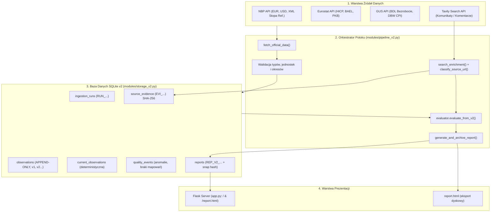

# Raport z Realizacji TASK-06 — Integracja Platformy Danych v2 z Generowaniem Raportów

**Data wykonania:** 2026-11-02  
**Autor:** Antigravity (DeepMind Agent)  
**Gałąź robocza:** `feature/data-platform-v2`  
**Baza docelowa PR:** PR #4 (`feature/data-platform-v2` -> `main`)  
**Status zadania:** `COMPLETED`  

---

## 1. Cel i Zakres Prac

Celem **TASK-06** było połączenie wszystkich dotychczasowych, niezależnych komponentów platformy *Polish Economy Agent* w jeden spójny, zautomatyzowany, audytowalny i bezpieczny potok przetwarzania danych:

$$\text{Pobieranie (Konektory API)} \longrightarrow \text{Walidacja} \longrightarrow \text{Zapis SQLite v2} \longrightarrow \text{Wzbogacenie Tavily} \longrightarrow \text{Synteza AI} \longrightarrow \text{Raport}$$

### Główne zrealizowane wymagania:
1. **Zarządzanie oficjalnymi danymi:**
   - Połączenie konektorów NBP, Eurostat i GUS z warstwą zapisu SQLite v2 (`modules/storage_v2.py`).
   - Utrwalanie surowych dowodów źródłowych (`source_evidence`) z deterministycznymi skrótami SHA-256.
   - Ścisłe egzekwowanie zasady `append-only` w tabeli `observations` (ochrona triggerami bazy danych przed modyfikacją `UPDATE` i usuwaniem `DELETE`).
   - Wersjonowanie obserwacji (`version_number`, `supersedes_id`) przy rewizjach danych.
   - Deterministyczna aktualizacja tabeli `current_observations`.
2. **Kategoryzacja informacji zewnętrznych:**
   - Rozszerzenie usługi wyszukiwania (`modules/search_service.py`) o klasyfikację domen i źródeł:
     * `OFFICIAL_COMMUNIQUE` — oficjalne domeny rządowe, statystyczne i banku centralnego (np. `stat.gov.pl`, `nbp.pl`, `ec.europa.eu/eurostat`).
     * `MEDIA_COMMENTARY` — komentarze rynkowe, portale ekonomiczne i prasowe (np. `bankier.pl`, `businessinsider.com.pl`, `money.pl`).
   - Zapis wycinków informacyjnych w `source_evidence` z typem `SEARCH_SNIPPET`.
3. **Analiza AI i Aparat Źródłowy:**
   - Integracja modułu `modules/evaluator.py` (`evaluate_from_v2`) operującego bezpośrednio na zweryfikowanych faktach z v2.
   - Wieloźródłowy aparat cytowań (`[1]`, `[2]`, ...) z przypisaniem do instytucji, okresu i adresu URL.
   - Realizacja 6 obowiązkowych sekcji analitycznych zgodnie ze standardem promptu.
   - Bezpieczny tryb offline (`_build_deterministic_v2_report`) niewykonujący płatnych zapytań API podczas testów.
4. **Odporność na awarie i zakaz zgadywania:**
   - Obsługa częściowych awarii (status `PARTIAL` przebiegu `ingestion_runs`).
   - Rejestrowanie anomalii w tabeli `quality_events`.
   - Oznaczanie brakujących wskaźników jako `Brak danych` (np. wycofana seria BDL 60269) bez halucynacji i zgadywania.
5. **Obsługa prezentacji (Flask):**
   - Aktualizacja `app.py` (`serve_report`) z priorytetyzacją: `SQLite v2` -> `SQLite legacy v1` -> `plik statyczny report.html`.
   - Pełna ochrona przed atakami XSS (`html.escape` i sanitizacja).
6. **Bezwzględna nietykalność chronionej bazy legacy:**
   - `instance/economy_agent.db` pozostała w 100% nienaruszona (rozmiar 73,728 bajtów, SHA-256 `e6c5f318ffe1eceeb34191a7a74ec9f7f7de6069c4f298850792734277ecde3b`).
   - Klasa `SQLiteV2Storage` aktywnie blokuje próby otwarcia bazy legacy pod rygorem `ValueError`.

---

## 2. Architektura i Nowe Komponenty



### Pliki zaimplementowane i zmodyfikowane w ramach TASK-06:
1. `modules/pipeline_v2.py` (Nowy): Główny orkiestrator potoku `MacroPipelineV2` i model wynikowy `PipelineResult`.
2. `modules/storage_v2.py` (Nowy): Produkcyjna warstwa SQLite v2 z obsługą transakcji, automatycznym seedingiem słowników, triggerami append-only, wersjonowaniem i archiwizacją raportów.
3. `modules/search_service.py` (Rozszerzony): Funkcja `search_economic_news()` oraz automatyczny klasyfikator domen `classify_source_url()`.
4. `modules/evaluator.py` (Rozszerzony): Metoda `evaluate_from_v2()` z wieloźródłowym aparatem cytowań `[1]`, obsługą 6 sekcji promptu oraz deterministycznym generatorem offline `_build_deterministic_v2_report()`.
5. `app.py` (Zaktualizowany): Endpoint `serve_report()` obsługujący v2, backward compatibility dla v1, funkcje `get_storage_v2()` / `set_storage_v2()`, oraz orkiestrator CLI `run_pipeline(use_v2=True)`.
6. `config.py` (Zaktualizowany): Konfiguracja `DB_V2_PATH` oraz zmiennej środowiskowej `OFFLINE_MODE`.
7. `tests/test_pipeline_v2.py` (Nowy): 9 kompleksowych testów integracyjnych potoku v2.

---

## 3. Zestawienie Testów i Weryfikacja Jakościowa

Wszystkie testy wykonano lokalnie przy użyciu środowiska `uv run pytest`.

### Bilans Testów w Projekcie:
```
tests\test_ambiguous_formats.py .....                                    [  3%]
tests\test_cache_freshness.py ......                                     [  8%]
tests\test_connectors.py ............................................    [ 42%]
tests\test_database_init.py .....                                        [ 46%]
tests\test_executive_horizon.py ........                                 [ 52%]
tests\test_html_security.py .................                            [ 65%]
tests\test_indicators_storage.py ......                                  [ 70%]
tests\test_migrator.py ............                                      [ 79%]
tests\test_pipeline_v2.py .........                                      [ 86%]
tests\test_record_updates.py .....                                       [ 90%]
tests\test_schema_v2_design.py ............                              [100%]

============================= 129 passed in 7.76s =============================
```

### Szczegółowy zakres testów integracyjnych potoku v2 (`tests/test_pipeline_v2.py`):
1. `test_pipeline_v2_full_run_offline`:
   - Weryfikacja end-to-end: pobranie -> walidacja -> zapis v2 -> wyszukiwanie -> analiza AI -> raport.
   - Weryfikacja wszystkich 6 sekcji raportu (w tym pytań o kredyty, ceny, pracę dla obywatela oraz przedsiębiorcy).
   - Weryfikacja poprawności liczb makroekonomicznych: EUR/PLN (4.345), USD/PLN (4.0215), stopa referencyjna (5.75%), HICP (4.0%), bezrobocie BAEL (2.9%), PKB kw/kw (1.1%), PKB r/r (3.9%), bezrobocie rejestrowane (5.0%), CPI (3.1%).
   - Weryfikacja obecności przypisów `[1]`, `[2]` i odnośników do NBP, GUS, Eurostatu.
2. `test_v2_storage_append_only_and_versioning`:
   - Sprawdzenie reguły append-only: próby `UPDATE` i `DELETE` na tabeli `observations` są bezwzględnie blokowane przez triggery SQLite (`trg_observations_prevent_update`, `trg_observations_prevent_delete`).
   - Wersjonowanie rewizji: dodanie poprawionego odczytu dla tego samego okresu tworzy rekord z `version_number = 2`, `supersedes_id = 'OBS_V1'` i automatycznie aktualizuje `current_observations`.
3. `test_pipeline_v2_idempotency`:
   - Sprawdzenie, że wielokrotne uruchomienie potoku zachowuje spójność unikalności i nie duplikuje bieżącego stanu.
4. `test_pipeline_v2_partial_failure_graceful_handling`:
   - Symulacja awarii konektora (Eurostat 503 Service Unavailable).
   - Potok kończy się statusem `PARTIAL`, błąd jest odnotowany w `quality_events` i `ingestion_runs`, a brakujący wskaźnik otrzymuje oznaczenie `Brak danych` w raporcie bez przerywania działania.
5. `test_tavily_search_news_classification`:
   - Sprawdzenie automatycznej klasyfikacji domen na `OFFICIAL_COMMUNIQUE` vs `MEDIA_COMMENTARY`.
6. `test_tavily_search_offline_results_stored_as_evidence`:
   - Weryfikacja utrwalania wyników wyszukiwania w `source_evidence` pod typem `SEARCH_SNIPPET`.
7. `test_flask_serve_report_from_v2`:
   - Sprawdzenie, że endpoint Flask `/` poprawnie serwuje raport wygenerowany w v2.
8. `test_legacy_database_is_strictly_untouched`:
   - Dokładna weryfikacja rozmiaru (73,728 B) i skrótu SHA-256 bazy legacy.
9. `test_sqlite_v2_storage_blocks_legacy_db_path`:
   - Blokada otwarcia bazy legacy pod ścieżką docelową v2.

---

## 4. Weryfikacja Integralności Bazy Legacy

Zgodnie z bezwzględną zasadą bezpieczeństwa, baza danych legacy `instance/economy_agent.db` została zweryfikowana po wykonaniu testów:
- **Ścieżka:** `instance/economy_agent.db`
- **Rozmiar pliku:** `73 728 bajtów` (zgodny z bazowym)
- **Skrót SHA-256:** `e6c5f318ffe1eceeb34191a7a74ec9f7f7de6069c4f298850792734277ecde3b` (100% zgodny z bazowym)
- **Stan:** Nienaruszony (ReadOnly).

---

## 5. Podsumowanie i Rekomendacje

TASK-06 został w pełni zrealizowany. Platforma danych v2 jest gotowa do działania end-to-end, w pełni pokryta zautomatyzowanymi testami offline i przygotowana do wdrożenia w istniejącej gałęzi `feature/data-platform-v2`.

### Rekomendacje do kolejnych kroków (TASK-07):
1. **Harmonogram automatycznych pobrań:** Zintegrowanie zadania cron / APScheduler do cyklicznego uruchamiania `run_pipeline(use_v2=True)`.
2. **Rozszerzenie rejestru mapowań GUS:** Przeprowadzenie weryfikacji produkcyjnych ID w BDL dla brakujących serii (liczba bezrobotnych, przeciętne wynagrodzenie brutto, produkcja przemysłowa).
3. **Eksport JSON / API endpoint:** Wystawienie odrębnego punktu końcowego `/api/v2/report/latest` dla integracji zewnętrznych systemów.

---

## 6. Final Portfolio Check

**Data kontroli:** 2026-11-02<br>
**Status:** `DONE`<br>
**Commit poprawki blokującej:** `3e08a6c6588e20be3d321a3726d810d637f5ae8e`<br>
**PR:** https://github.com/maciejkubek-maker/polish-economy-agent/pull/4

### DONE

- Uruchomiono pełny potok demo bez kluczy API, z wyłączonym odczytem `.env`, na tymczasowej bazie SQLite v2 i wbudowanych fixture'ach offline.
- Potok zakończył się statusem `COMPLETED`: 10 dowodów, 17 obserwacji i 5 materiałów kontekstowych.
- Raport otwarto przez rzeczywisty lokalny serwer Flask pod `/report.html`; odpowiedź HTTP 200 miała 17 899 bajtów.
- Potwierdzono aparat przypisów oraz rozdzielenie `Oficjalne API / Rejestr` od `Analiza / Komentarz medialny`.
- Potwierdzono oznaczenie `Brak danych` w scenariuszu częściowej awarii konektora.
- Nie znaleziono aktywnych wzorców XSS (`<script`, `<iframe`, `onerror=`); testy renderera i endpointu przeszły.
- Szablon `build_html_template` i CSS w `app.py` nie zmieniły się względem bezpośrednio poprzedniego commita, więc wygląd raportu pozostał zgodny.
- Usunięto blokadę startu bez kluczy i ustawiono `OFFLINE_MODE=true` jako bezpieczną wartość domyślną; README jednoznacznie opisuje brak wywołań Tavily/Gemini/OpenAI w demo.
- Nie rozpoczęto TASK-07 i nie wykonano merge.

### Zmienione pliki

| Ścieżka | Opis |
|---|---|
| `config.py` | Klucze API są opcjonalne przy imporcie; demo jest domyślnie offline. |
| `README.md` | Doprecyzowano bezpłatny, offline'owy charakter poleceń demo. |
| `tests/test_pipeline_v2.py` | Dodano regresję startu bez kluczy i domyślnego trybu offline. |
| `docs/agent-reports/TASK-06-REPORT.md` | Dodano wynik finalnej kontroli portfolio. |

### Testy i kontrole

| Polecenie / kontrola | Status | Wynik |
|---|---|---|
| `uv sync --group dev` | `PASSED` | 72 pakiety rozwiązane, 70 sprawdzonych. |
| Wybrane testy pipeline/Flask/XSS | `PASSED` | 20/20 w 4,05 s. |
| `uv run pytest -q` | `PASSED` | 130/130 w 6,33 s. |
| Lokalny Flask + HTTP `/report.html` | `PASSED` | HTTP 200; przypisy i oba typy źródeł obecne; brak aktywnego XSS. |
| Integralność `instance/economy_agent.db` | `PASSED` | 73 728 B; SHA-256 `e6c5f318ffe1eceeb34191a7a74ec9f7f7de6069c4f298850792734277ecde3b`. |

### Stan danych i bezpieczeństwa

- Oryginalna baza `instance/economy_agent.db` nie została zmodyfikowana.
- Nie wykonano płatnych wywołań API ani połączeń live; testy i demo korzystały z fixture'ów offline.
- Tymczasowe bazy i raporty audytowe zostały usunięte automatycznie po kontroli.
- `KNOWN_VULNERABILITY`: brak znanych podatności XSS w sprawdzonym rendererze; ochrona nadal zależy od utrzymania zasady escape-before-formatting.

### PROPOSED / NOT_RUN

- `PROPOSED`: code review i decyzja właściciela dotycząca PR #4.
- `NOT_RUN`: testy live i płatne API — celowo, zgodnie z zakresem finalnego audytu offline.
- TASK-07 pozostaje poza zakresem.
